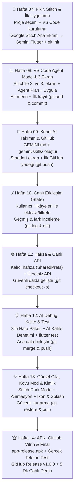

# 🗺️ Dönem Projesi Ana Planı (Hafta 07 – Hafta 14)

> **Öğrenciler İçin Yol Haritası:** Bu doküman, **7. haftadan 14. haftaya kadar** (8 hafta boyunca) geliştireceğiniz mobil uygulamanın **resmi senaryosunu, haftalık teslim hedeflerini, araç akışını ve değerlendirme kriterlerini** içerir.
>
> Kod ezberlemeden, tasarım programı bilmeden ve önceden GitHub deneyiminiz olmadan; **VS Code + Google Stitch + Gemini Code Assist (Agent Mode) + Skills + Mikro-Git** düzeniyle bu planı takip ederek 14. haftada gerçek telefonlara kurulabilen kendi mobil uygulamanızı (`v1.0.0` APK) yayınlayacaksınız!

---

## 🎯 1. Projenin Genel Senaryosu (Büyük Resim)



---

## 💡 2. Proje Fikri Kataloğu (Hafta 07'de Seçimini Yap!)

Her öğrenci aşağıdaki **hazır senaryolardan birini** seçebilir veya aynı kriterlere uyan **kendi özgün fikrini** (8. seçenek) eğitmen onayıyla belirleyebilir. Tüm senaryolar 8 haftalık akışa, ücretsiz/anahtarsız API kullanımına ve 3 ekran yapısına tam uyumludur:

| # | Uygulama Adı | Kim İçin / Ne İşe Yarar? | 3 Ana Ekran Planı | Etkileşimli Özellik (H10) | Ücretsiz Canlı API Önerisi (H11) |
|---|---|---|---|---|---|
| **1** | **KampüsCep** *(Ders Ana Örneği)* | Öğrenci günlük ders, ödev ve kampüs asistanı | Ana Sayfa • Derslerim • Profil | Görev ekle, tamamla, filtrele, sil + ilerleme çubuğu | [Open-Meteo](https://open-meteo.com) (Kampüs canlı hava durumu) |
| **2** | **Kitaplığım** | Okunan & okunacak kitap takibi | Özet & Hedef • Kitaplarım • Profil | Kitap ekle, sayfa/durum güncelle, favorile, sil | [Open Library API](https://openlibrary.org/developers/api) (Kitap arama & kapak) |
| **3** | **BütçeCep** | Öğrenci harçlık & harcama yöneticisi | Aylık Özet • Harcamalar • Profil | Gelir/gider ekle, kategoriye göre filtrele, toplam hesapla | [Frankfurter API](https://www.frankfurter.app) (Canlı döviz kuru) |
| **4** | **FitGün** | Günlük su, yürüyüş ve alışkanlık takibi | Günlük Hedef • Alışkanlıklar • Profil | Su/alışkanlık ekle, günlük tik at, yüzde hedef çubuğu | [Open-Meteo](https://open-meteo.com) (Koşu/yürüyüş hava önerisi) |
| **5** | **TarifDefterim** | Pratik öğrenci yemekleri ve alışveriş listesi | Günün Önerisi • Tariflerim • Profil | Kendi tarifini/malzemeni ekle, favorile, sil | [TheMealDB API](https://www.themealdb.com/api.php) (Günün rastgele yemeği) |
| **6** | **DilKartım** | İngilizce/yabancı dil kelime ezber kartları | Günlük Seri • Kelime Kartları • Profil | Yeni kelime ekle, "Öğrendim" işaretle, filtrele | [Free Dictionary API](https://dictionaryapi.dev) (Anlam & telaffuz) |
| **7** | **İzlemeListem** | Film & dizi takip ve kişisel puanlama | Keşfet/Özet • Listem • Profil | Film/dizi ekle, izlendi işaretle, 1–5 yıldız ver | [TVMaze API](https://www.tvmaze.com/api) (Dizi arama & özet) |
| **8** | **Özgün Fikir** | Öğrencinin kendi belirlediği gerçek hayat problemi | 3 Ekran + Alt Menü | Ekleme, listeleme, filtreleme, silme | API anahtarı gerektirmeyen herhangi bir JSON API |

> **Önemli:** Hafta 07'de seçtiğin proje konusunu 14. haftaya kadar değiştirmiyoruz; her hafta **aynı uygulamanın üzerine** yeni yetenek ekliyoruz!

---

## 📅 3. Haftalık Zorunlu İlerleme Planı (Hafta 07 – 14)

Öğrenciler her hafta aşağıdaki **4 sütunu** tamamlayarak bir sonraki haftaya geçer:

| Hafta | Hedef & Teslim Çıktısı | Google Stitch Görevi | VS Code + Gemini Görevi | Zorunlu Mikro-Git Adımı |
|---|---|---|---|---|
| **Hafta 07** | **Proje Seçimi + Stitch Ana Ekran (v0.1)**<br/>`PROJE-KARTIM.md` doldurulur, ilk Stitch ekranı VS Code'da çalışır | Ana Ekranı tasarla, renk paletini belirle, `tasarimlar/ana_ekran_stitch.png` kaydet | VS Code + Flutter + Gemini Code Assist kur; **R-B-G-K prompt** + Stitch görseli ile ilk ekranı çalıştır | `git init`<br/>`git status` |
| **Hafta 08** | **3 Ekranlı Mimari & İlk Kayıt (v0.2)**<br/>Alt menüyle çalışan 3 ayrı ekran dosyası | Aynı Stitch projesinde **2. ve 3. ekranı** tasarla (`tasarimlar/` klasörüne kaydet) | **Agent Mode** aç → *Önce Plan, Sonra Uygula* ile `lib/screens/` klasörünü ve Alt Menüyü kur | `git add .`<br/>`git commit -m "Hafta 8: 3 ekranlı mimari"` |
| **Hafta 09** | **AI Kuralları, Skills & İlk GitHub Yedeği (v0.3)**<br/>`GEMINI.md` + `.gemini/skills/` aktif, proje GitHub'da yayında | Yeni eklenecek kart/ekran bileşeninin stilini doğrula | Proje köküne `GEMINI.md` ve `.gemini/skills/stitch-to-flutter/SKILL.md` ekle; kısa prompt ile standart yeni ekran üret | `git remote add origin ...`<br/>`git push -u origin main` |
| **Hafta 10** | **Etkileşim & Canlı Durum (v0.4)**<br/>Kullanıcı veri ekleyip güncelleyebiliyor | Ekleme penceresi (BottomSheet/Modal) + Boş Durum ekranı tasarla | **Kullanıcı Hikâyesi** tablosu ile ekleme, doğrulama, tamamlama, filtreleme, geri almalı silme ekle | `git log --oneline`<br/>`git diff`<br/>`commit` + `push` |
| **Hafta 11** | **Kalıcı Hafıza & Canlı API (v0.5)**<br/>Kapanınca silinmeyen veri + gerçek internet verisi | Canlı bilgi kartı + Yükleniyor (Loading) + İnternet Yok ekranı tasarla | `shared_preferences` ile kalıcı hafıza + `http` ile seçtiğin ücretsiz API'yi `lib/services/` altına bağla | `git checkout -b ozellik/api-hafiza`<br/>*(yeni dalda `commit`)* |
| **Hafta 12** | **AI Debug, Kalite Denetimi & Test (v0.7)**<br/>Taşmasız, hatasız, test edilmiş kararlı sürüm | Hata ve taşma (360px küçük ekran) durumlarını görsel olarak doğrula | **3'lü Hata Paketi** + **Kalite Denetçisi** prompt'u ile hataları ayıkla; AI ile temel `flutter test` yazdırıp çalıştır | `git switch main`<br/>`git merge ozellik/api-hafiza`<br/>`git push` |
| **Hafta 13** | **Görsel Cila, Koyu Mod, İkon & Splash (v0.9)**<br/>Mağaza kalitesinde koyu modlu, ikonlu ve animasyonlu uygulama | **Koyu Mod (Dark Mode)** varyantı + **1024×1024 uygulama ikonu** tasarla | Hafızalı Açık/Koyu tema geçişi, mikro animasyonlar (`AnimatedContainer`), `flutter_launcher_icons` ve Splash ekranı ekle | `git restore <dosya>` *(pratik)*<br/>`git pull`<br/>`commit` + `push` |
| **Hafta 14** | **APK Yayını, GitHub Vitrin & Final Sunumu (v1.0.0)**<br/>Telefonda kurulu APK + GitHub Release + 5 Dk Canlı Demo | Tüm ekranların son görsel tutarlılık ve sunum ekran görüntüleri | `flutter build apk --release` al; gerçek telefonda test et; AI ile GIF'li/rozetli profesyonel `README.md` hazırla | `git tag v1.0.0`<br/>`git push --tags`<br/>**GitHub Release (APK)** |

---

## 📁 4. 14. Hafta Sonunda Hedeflenen Proje Klasör Yapısı

Planı eksiksiz uyguladığında GitHub depon aşağıdaki profesyonel yapıya kavuşmuş olacak:

```text
proje-adin/
├── GEMINI.md                              # Proje anayasası (Hafta 09)
├── PROJE-KARTIM.md                        # Proje kimlik kartın (Hafta 07)
├── README.md                              # GIF'li, rozetli portfolyo vitrini (Hafta 14)
├── .gemini/
│   └── skills/
│       └── stitch-to-flutter/
│           └── SKILL.md                   # Özel AI yeteneğin (Hafta 09)
├── tasarimlar/                            # Google Stitch tasarım ekranların (Hafta 7, 8, 10, 13)
│   ├── ana_ekran_stitch.png
│   ├── ekran2_stitch.png
│   ├── profil_stitch.png
│   └── koyu_mod_stitch.png
├── assets/
│   └── icon/app_icon.png                  # Uygulama ikonu (Hafta 13)
├── test/                                  # AI destekli temel testler (Hafta 12)
└── lib/
    ├── main.dart                          # Tema, Koyu Mod, Splash & Alt Menü yöneticisi
    ├── screens/                           # 3+ ayrı ekran dosyası (Hafta 08+)
    ├── widgets/                           # Tekrar eden kart & bileşenler (Hafta 09+)
    └── services/                          # Kalıcı hafıza & Canlı API servisleri (Hafta 11)
```

---

## 📝 5. Hafta 07 Teslimi: Öğrenci Proje Kimlik Kartı (Kopyala & Doldur)

Her öğrenci **7. haftanın sonunda** aşağıdaki kartı doldurup projesinin ana klasörüne `PROJE-KARTIM.md` adıyla kaydeder (ve eğitmene onaylatır):

```markdown
# 📱 Proje Kimlik Kartım

- **Öğrenci Adı Soyadı / Numara:** 
- **Uygulama Adı:** (Örn. KampüsCep / Kitaplığım / ...)
- **Tek Cümlelik Özet:** Bu uygulama [hedef kitle] için [hangi sorunu] çözer.
- **Hedef 3 Ekran:**
  1. Ekran 1 (Ana Sayfa): 
  2. Ekran 2 (Liste / Ana Özellik): 
  3. Ekran 3 (Profil / Ayarlar): 
- **Etkileşimli İşlemler (Hafta 10):** Kullanıcı ne ekleyecek, neyi güncelleyip silecek?
- **Kullanılacak Ücretsiz API (Hafta 11):** (Örn. Open-Meteo / TheMealDB / Open Library)
- **Seçilen Stitch Renk Paleti (Hafta 07):** Ana Renk + Vurgu Rengi
- **GitHub Repo Adresi (Hafta 09'da eklenecek):** https://github.com/kullanici/proje-adi
```

---

## 📊 6. Dönem Sonu Değerlendirme Rubriği (100 Puan)

| Değerlendirme Kriteri | Puan | Beklenen Kalite Standardı |
|---|---|---|
| **1. Google Stitch Tasarım & Görsel Uyum** | **15** | `tasarimlar/` klasöründe Stitch ekran görüntüleri mevcut; uygulama tasarıma sadık, ferah ve %100 Türkçe |
| **2. AI Mimarisi (`GEMINI.md` & `.gemini/skills/`)** | **20** | Projeye özel yazılmış `GEMINI.md`, en az 1 çalışan `SKILL.md` ve temiz `lib/screens`, `lib/services` klasör yapısı |
| **3. Etkileşim (State) & Kalıcı Hafıza** | **20** | Veri ekleme, doğrulama, tamamlama/güncelleme, filtreleme, silme ve uygulama kapanınca verilerin korunması |
| **4. Canlı API, Hata Yönetimi & Test** | **15** | Gerçek ücretsiz API verisi + Yükleniyor/İnternet Yok ekranı + AI hata denetimi ve çalışan `flutter test` |
| **5. Görsel Cila, Koyu Mod, İkon & APK** | **15** | Hafızalı Açık/Koyu Mod, mikro animasyonlar, özel ikon/Splash ve gerçek telefonda kurulan `app-release.apk` |
| **6. Mikro-Git Sürekliliği, GitHub Vitrin & Sunum** | **15** | Haftalara yayılmış düzenli commit geçmişi, branch/merge kullanımı, `v1.0.0` Release, güçlü `README.md` ve 5 dk canlı demo |
| **TOPLAM** | **100** | |

---

## 🚨 7. Altın Kurallar (Başarı İçin 5 Temel Kural)

1. **Son Gece Tek Commit Yasak:** Her hafta derste veya ödev sonunda o haftanın Mikro-Git adımını uygula (`git log --oneline` geçmişinin 7.–14. haftalara yayılmış olması beklenir).
2. **Önce Tasarla, Sonra Kodlattır:** Yeni bir ekran eklemeden önce mutlaka Google Stitch'te görselleştirip `tasarimlar/` klasörüne kaydet.
3. **Körlemesine Kopyalama Yapma:** Gemini bir kodu değiştirdiğinde veya hatayı düzelttiğinde *"Bunu neden böyle yaptın? 2 cümleyle açıkla"* diye sor; mantığını kavra.
4. **Sadece Türkçe Arayüz:** Ekranda unutulmuş `Submit`, `Home`, `Settings`, `Error` gibi İngilizce metin bırakma.
5. **Gerçek Cihazda Test Et:** Final sunumundan en az 1 gün önce `app-release.apk` dosyasını bir Android telefonda kurup internetli ve internetsiz olarak dene!

---

### 🔗 Hızlı Bağlantılar
🚀 [Hafta 07 Dersine Başla](README.md) | 🏠 [14 Haftalık Ana Sayfa](../README.md) | 🤖 [Hafta 08: VS Code Agent Mode & 3 Ekran](../Hafta-08/README.md)
