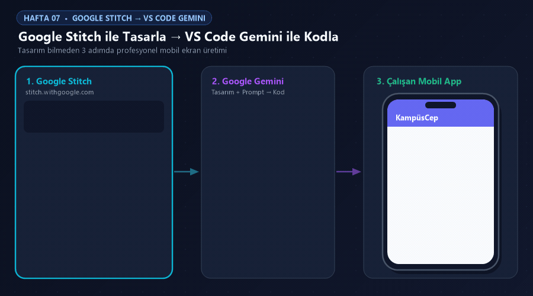
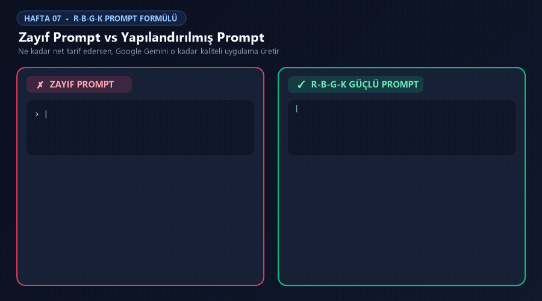

# 🚀 Hafta 07: Yapay Zeka ile Mobil Uygulamaya İlk Adım — Google Stitch ile Tasarla, VS Code Gemini ile Kodla

> **Bu hafta kod ezberlemiyoruz.** Önce mobil uygulama dünyasındaki temel kavramları sade bir dille öğreneceğiz. Sonra adım adım **Google Stitch** ile bir ekran tasarlayıp **VS Code içindeki Gemini** yapay zekâsına bu ekranı çalışan bir mobil uygulamaya dönüştürteceğiz.
>
> 📋 **Başlamadan önce:** 8 haftalık yol haritası, proje seçenekleri ve puanlama için **[Dönem Projesi Ana Planı (PROJE-PLANI.md)](PROJE-PLANI.md)** dosyasına göz at.



---

## 🗺️ Bu Hafta Ne Yapacağız?

| Bölüm | Ne Yapacağız? | Süre (Yaklaşık) |
|---|---|---|
| **Bölüm 1** | Temel kavramları öğreneceğiz (uygulama, Flutter, VS Code, yapay zekâ, prompt, Git...) | 30 dk |
| **Bölüm 2** | Adım adım: Proje seç → VS Code hazırla → Stitch'te tasarla → Gemini ile koda çevir → Çalıştır | 70 dk |
| **Bölüm 3** | İlk 2 Git komutumuzu çalıştıracağız | 10 dk |

> 🎯 **Hafta sonunda elinde olacaklar:** Seçtiğin proje fikri (`PROJE-KARTIM.md`), Google Stitch ile tasarlanmış bir ana ekran görseli ve bilgisayarında **çalışan ilk mobil uygulama ekranın**.

---

## 📖 BÖLÜM 1 — Önce Kavramları Öğrenelim

> Bu bölümde hiçbir şey kurmuyoruz, sadece okuyup anlıyoruz. Her kavram için **Basit Tanım → Günlük Hayat Benzetmesi → Bizim Projede Nerede?** sırasını izliyoruz.

### 1.1 Mobil Uygulama Nedir?
- **Basit Tanım:** Telefonda çalışan programdır (WhatsApp, Instagram, Hava Durumu gibi).
- **Benzetme:** Telefon bir **apartman**, her uygulama ise apartmandaki bir **daire**dir. Her dairenin kendi odaları (ekranları) vardır.
- **Bizim Projede:** 8 hafta sonunda kendi "daireni" (uygulamanı) inşa etmiş olacaksın.

### 1.2 Ekran (Sayfa) ve Arayüz (UI)
- **Basit Tanım:** **Ekran**, uygulamada aynı anda gördüğün sayfadır. **Arayüz (UI)** ise o sayfadaki buton, yazı, resim ve kartların tamamıdır.
- **Benzetme:** Ekran bir **oda**, arayüz ise odadaki **eşyalar ve dekorasyon**dur.
- **Bizim Projede:** Bu hafta sadece **1 ekran (Ana Sayfa)** yapacağız. Sonraki haftalarda 3 ekrana çıkacağız.

### 1.3 Flutter Nedir?
- **Basit Tanım:** Google'ın geliştirdiği, mobil uygulama yapmaya yarayan ücretsiz bir **araç setidir**. Flutter ile yazılan uygulama hem Android'de hem iPhone'da çalışabilir.
- **Benzetme:** Flutter bir **LEGO kutusudur**. Buton, yazı, kart gibi hazır parçalar içerir; bu parçaları birleştirip uygulama yaparız.
- **Bizim Projede:** Uygulamamız Flutter ile yapılacak ama **parçaları biz değil, yapay zekâ birleştirecek**. Biz ne istediğimizi tarif edeceğiz.

> 💡 **Dart** nedir? Flutter uygulamalarının yazıldığı programlama dilidir. İlk 6 haftada tanıdığımız `if`, `for`, `List` gibi yapılar Dart diliydi. Artık Dart kodunu biz yazmıyoruz; okuyup **anlamaya çalışmamız** yeterli.

### 1.4 VS Code (Visual Studio Code) Nedir?
- **Basit Tanım:** Kod dosyalarını açıp düzenlediğimiz ücretsiz bir **program (editör)**dür.
- **Benzetme:** VS Code bizim **atölyemizdir**. İçinde dosyalarımız (malzemeler), terminal (alet çantası) ve yapay zekâ asistanımız (usta yardımcısı) bulunur.
- **VS Code'un 4 önemli bölgesi:**

| Bölge | Nerede? | Ne İşe Yarar? |
|---|---|---|
| **Explorer (Dosya Gezgini)** | Sol üstteki 📄 simgesi | Proje dosyalarını ve klasörlerini gösterir |
| **Editör** | Ortadaki büyük alan | Açtığın dosyanın içeriğini gösterir |
| **Terminal** | Alt kısım (`` Ctrl + ` `` ile açılır) | Bilgisayara yazılı komut verdiğimiz siyah pencere |
| **Gemini Code Assist Paneli** | Sol menüdeki ✦ Gemini simgesi | Yapay zekâ ile sohbet ettiğimiz alan |

### 1.5 Eklenti (Extension) Nedir?
- **Basit Tanım:** VS Code'a yeni özellik kazandıran küçük ek programlardır.
- **Benzetme:** Telefonuna uygulama yüklemek gibi; VS Code'a da "yetenek" yüklüyoruz.
- **Bizim Projede:** 2 eklenti kuracağız: **Flutter** (uygulamayı çalıştırmak için) ve **Gemini Code Assist** (yapay zekâ için).

### 1.6 Terminal ve Komut Nedir?
- **Basit Tanım:** Terminal, bilgisayara fareyle tıklamak yerine **yazarak** emir verdiğimiz penceredir. Yazdığımız her emre **komut** denir.
- **Benzetme:** Restoranda menüdeki resme tıklamak yerine garsona sözlü sipariş vermek gibi.
- **Bizim Projede:** Her hafta 1-2 kısa komut yazacağız (örn. `flutter run` = "uygulamayı çalıştır").

> ✍️ **Komut yazma kuralları:** Komutu birebir aynı yaz → `Enter` tuşuna bas → çıktının bitmesini bekle. Kopyala-yapıştır yapabilirsin.

### 1.7 Emülatör ve Çalıştırma Hedefi (Cihaz)
- **Basit Tanım:** **Emülatör**, bilgisayar ekranında açılan **sanal telefondur**. Uygulamayı gerçek telefon olmadan denememizi sağlar.
- **Benzetme:** Uçuş simülatörü gibi; gerçek uçağa binmeden uçmayı denemek.
- **Bizim Projede:** Uygulamayı 3 yerden birinde çalıştırabiliriz:

| Hedef | Ne Zaman Kullanılır? |
|---|---|
| **Chrome (Tarayıcı)** | En kolay ve hızlı yöntem — başlangıç için önerilir |
| **Android Emülatör** | Telefon görünümünde test etmek için (Android Studio gerekir) |
| **Gerçek Android Telefon** | USB kablosuyla bağlayıp denemek için (Hafta 14'te APK ile de kuracağız) |

### 1.8 Yapay Zekâ (AI) ve Google Gemini
- **Basit Tanım:** Yapay zekâ, yazdığımız Türkçe cümleleri anlayıp cevap veren, kod yazabilen, görseli inceleyebilen bir bilgisayar sistemidir. **Google Gemini** de Google'ın yapay zekâsıdır.
- **Benzetme:** Gemini, istediğin her şeyi hızlıca yapan ama **ne istediğini net söylemen gereken** çok yetenekli bir **stajyerdir**.
- **Bizim Projede:** Gemini'yi VS Code içinde **Gemini Code Assist** eklentisiyle kullanacağız.

### 1.9 Prompt (İstem) Nedir?
- **Basit Tanım:** Yapay zekâya yazdığımız istek/talimat metnidir.
- **Benzetme:** Terziye "bana bir şey dik" dersen ne çıkacağı belli olmaz. "Lacivert, uzun kollu, M beden gömlek" dersen tam istediğini alırsın.
- **Bizim Projede:** Bu hafta iyi prompt yazmanın formülünü (**R-B-G-K**) öğreneceğiz.

### 1.10 Google Stitch ve Tasarım
- **Basit Tanım:** Google Stitch (`stitch.withgoogle.com`), yazdığın cümlelerden **profesyonel uygulama ekranı tasarımı** çizen ücretsiz bir yapay zekâ aracıdır.
- **Benzetme:** Stitch bir **mimar**, Gemini ise **inşaat ustası**dır. Önce mimar evin çizimini yapar, sonra usta o çizime bakarak evi inşa eder.
- **Bizim Projede:** Önce Stitch'te ekranın **resmini** yapacağız, sonra bu resmi Gemini'ye verip **çalışan ekrana** dönüştüreceğiz.

> 🎨 **Tasarım dili kelimeleri** (Stitch'e yazarken işine yarar):
> - **Renk paleti:** Uygulamada kullanılan ana renkler (örn. Indigo `#4F46E5`, Yeşil `#10B981`). `#` ile başlayan koda **HEX renk kodu** denir.
> - **Kart (Card):** Köşeleri yuvarlatılmış, içinde bilgi olan kutu.
> - **Köşe yarıçapı (radius):** Kart köşelerinin ne kadar yuvarlak olduğu (16px = yumuşak yuvarlak).
> - **Alt menü (Bottom Navigation):** Ekranın en altındaki sekmeler (Ana Sayfa, Profil gibi).
> - **Material 3:** Google'ın modern tasarım kuralları; uygulamaların derli toplu görünmesini sağlar.

### 1.11 Git Nedir?
- **Basit Tanım:** Projendeki dosyaların **geçmişini kaydeden** bir sistemdir. İstediğin an eski hâline dönebilirsin.
- **Benzetme:** Bilgisayar oyunlarındaki **kayıt noktası (save)** gibi.
- **Bizim Projede:** Ayrı bir Git dersi yok; her hafta sadece 1-2 komut öğreneceğiz. Bu hafta: `git init` (kayıt sistemini başlat) ve `git status` (durumu göster).

### 📌 Kavram Özet Tablosu

| Kavram | Tek Cümlelik Hatırlatma |
|---|---|
| Ekran / Arayüz | Uygulamada gördüğün sayfa ve üzerindeki parçalar |
| Flutter | Mobil uygulama yapan LEGO kutusu (Google) |
| VS Code | Projemizi geliştirdiğimiz atölye programı |
| Eklenti | VS Code'a yüklenen ek yetenek |
| Terminal / Komut | Bilgisayara yazarak emir verdiğimiz pencere |
| Emülatör | Bilgisayardaki sanal telefon |
| Gemini | VS Code içindeki yapay zekâ yardımcımız |
| Prompt | Yapay zekâya yazdığımız net talimat |
| Google Stitch | Ekran tasarımını çizen yapay zekâ mimarı |
| Git | Projenin kayıt noktası sistemi |

---

## 🛠️ BÖLÜM 2 — Adım Adım: AI ile İlk Mobil Ekranımızı Üretelim

> Her adımda **Ne yapıyoruz? → Nasıl yapıyoruz? → ✔️ Başarılı oldu mu?** sırasını takip et. Bir adımın kontrolü tamam olmadan sonrakine geçme.

### ▶️ Adım 1: Proje Fikrini Seç ve Proje Kartını Doldur
**Ne yapıyoruz?** 8 hafta boyunca geliştireceğin uygulamanın konusunu belirliyoruz.

1. [PROJE-PLANI.md](PROJE-PLANI.md) içindeki **Proje Fikri Kataloğu** tablosundan bir fikir seç (örneklerde **KampüsCep** kullanacağız).
2. Aynı dosyanın **5. bölümündeki** "Proje Kimlik Kartı" şablonunu kopyala; Adım 3'te oluşturacağın proje klasörüne `PROJE-KARTIM.md` adıyla kaydedip doldur.

✔️ **Kontrol:** Uygulamanın adını, 3 ekranını ve tek cümlelik amacını söyleyebiliyor musun?

### ▶️ Adım 2: VS Code'a Eklentileri Kur
**Ne yapıyoruz?** Atölyemize iki yeteneği yüklüyoruz.

1. VS Code'u aç.
2. Sol menüdeki **Extensions** (⊞ dört kare simgesi) bölümüne tıkla veya `Ctrl + Shift + X` tuşlarına bas.
3. Arama kutusuna **`Flutter`** yaz → **Install** düğmesine bas (Dart eklentisi de otomatik kurulur).
4. Arama kutusuna **`Gemini Code Assist`** yaz → **Install** düğmesine bas.
5. Sol menüde beliren **✦ Gemini** simgesine tıkla → **Sign in with Google** ile Google hesabına giriş yap.

✔️ **Kontrol:** Sol menüde Gemini simgesi görünüyor ve tıklayınca sohbet kutusu açılıyor mu?

> 🏫 **Not:** Flutter SDK laboratuvar bilgisayarlarında kurulu olarak gelir. Kendi bilgisayarında çalışacaksan kurulum için eğitmenine danış veya [flutter.dev](https://flutter.dev) adresindeki "Get started" adımlarını izle.

### ▶️ Adım 3: Flutter Projesini Oluştur
**Ne yapıyoruz?** Uygulamamızın boş klasörünü ve başlangıç dosyalarını oluşturuyoruz.

1. VS Code'da üst menüden **Terminal → New Terminal** seç (veya `` Ctrl + ` `` tuşlarına bas). Altta terminal açılır.
2. Aşağıdaki komutları **tek tek** yaz, her birinden sonra `Enter`'a bas:
   ```bash
   flutter create kampus_cep
   cd kampus_cep
   code .
   ```

| Komut | Ne Yapar? |
|---|---|
| `flutter create kampus_cep` | `kampus_cep` adında hazır bir Flutter projesi oluşturur |
| `cd kampus_cep` | Terminali bu proje klasörünün içine taşır (`cd` = klasöre gir) |
| `code .` | Bu klasörü yeni bir VS Code penceresinde açar |

3. Yeni açılan VS Code penceresinde soldaki **Explorer**'a bak. `lib` klasörünün içinde **`main.dart`** dosyasını göreceksin. Uygulamamızın ana dosyası budur.
4. Explorer'da boş bir alana sağ tıkla → **New Folder** → adını **`tasarimlar`** koy. Stitch görsellerimizi buraya koyacağız.

✔️ **Kontrol:** Explorer'da `lib/main.dart` ve `tasarimlar/` klasörü görünüyor mu?

### ▶️ Adım 4: Google Stitch ile Ana Ekranı Tasarla
**Ne yapıyoruz?** Mimarımız Stitch'e ana ekranın çizimini yaptırıyoruz.

1. Tarayıcıda **[stitch.withgoogle.com](https://stitch.withgoogle.com)** adresine git ve Google hesabınla giriş yap.
2. Tasarım türü olarak **Mobile (Mobil)** seç.
3. Aşağıdaki tasarım prompt'unu yapıştır (kendi projen farklıysa uygulama adını ve bölümleri değiştir):

```text
Design a clean, modern mobile app home screen for university students named "KampüsCep" (Turkish UI).
Style: Light mode, Material 3 inspired, primary color Indigo (#4F46E5), accent Emerald (#10B981), soft rounded cards (16px radius), generous whitespace.
Sections from top to bottom:
1. Top greeting header: "Merhaba, Zeynep" with avatar icon and notification bell.
2. Hero summary card in Indigo gradient: "Bugün 3 Dersin Var" and next class badge "10:00 • Mobil AI Lab".
3. Horizontal quick action chips: "Ders Programı", "Görevler", "Yemekhane", "Duyurular".
4. Vertical list of 3 modern class cards with left color indicator, time, course title, and room number.
5. Bottom navigation bar with 3 items: "Ana Sayfa", "Derslerim", "Profil".
```

> 💡 **Neden İngilizce?** Stitch İngilizce tarifleri çok iyi anlar. Ekranda görünecek Türkçe yazıları tırnak içinde (`"Ana Sayfa"`) vermen yeterli.

4. Çıkan tasarımı incele. Beğenmediğin bir şey varsa Stitch'in sohbet kutusuna yaz:
   - *"Make the cards more rounded and the colors softer."* (Kartları daha yuvarlak, renkleri daha yumuşak yap.)
   - *"Use larger text for titles."* (Başlıklar için daha büyük yazı kullan.)
5. Beğendiğinde tasarımı **PNG resim olarak indir** ve VS Code'daki `tasarimlar` klasörüne **`ana_ekran_stitch.png`** adıyla kaydet.
6. *(İsteğe bağlı ama önerilir)* Stitch'te **Export / Code** seçeneği varsa çıkan kodu kopyala, `tasarimlar` klasöründe **`ana_ekran_stitch.html`** adında bir dosya oluşturup içine yapıştır. Gemini bu dosyadan renkleri ve yerleşimi daha kolay okur.

✔️ **Kontrol:** `tasarimlar/ana_ekran_stitch.png` dosyası VS Code Explorer'da görünüyor mu?

### ▶️ Adım 5: İyi Prompt Formülünü Öğren — R-B-G-K
**Ne yapıyoruz?** Gemini'ye talimat yazmadan önce iyi prompt'un 4 parçasını öğreniyoruz.

| Harf | Parça | Kendine Sor | Örnek |
|---|---|---|---|
| **R** | **Rol** | Yapay zekâ kim gibi davransın? | *"Sen uzman bir Flutter geliştiricisisin."* |
| **B** | **Bağlam** | Ne için, kimin için yapıyoruz? | *"Üniversite öğrencileri için KampüsCep uygulaması yapıyoruz."* |
| **G** | **Görev** | Tam olarak ne yapsın? | *"Ekteki Stitch tasarımına birebir uyan ana ekranı oluştur."* |
| **K** | **Kısıt** | Uyması gereken kurallar neler? | *"Yazılar Türkçe olsun, ekran küçük telefonlara sığsın."* |



✔️ **Kontrol:** "Bana uygulama yap" cümlesinin R-B-G-K'nın hangi parçalarını eksik bıraktığını söyleyebiliyor musun? (Cevap: Rol, Bağlam ve Kısıt eksik; Görev de belirsiz.)

### ▶️ Adım 6: Tasarımı VS Code Gemini'ye Ver ve Koda Dönüştür
**Ne yapıyoruz?** İnşaat ustamız Gemini'ye, mimarın çizimini verip ekranı inşa ettiriyoruz.

1. VS Code'da sol menüden **✦ Gemini** panelini aç.
2. Sohbet kutusuna tasarım dosyanı ekle: Kutuya **`@`** yazıp listeden `tasarimlar/ana_ekran_stitch.png` (ve varsa `.html`) dosyasını seç. *(Görsel ekleme düğmesi 📎 varsa onunla da ekleyebilirsin.)*
3. Aşağıdaki R-B-G-K prompt'unu yapıştır ve gönder:

```text
ROL: Sen modern mobil tasarıma hâkim, yeni başlayanlara açıklama yapan bir Flutter geliştiricisisin.
BAĞLAM: Üniversite öğrencileri için "KampüsCep" mobil uygulamasını geliştiriyoruz. Ekte Google Stitch ile tasarladığım ana ekran var (@tasarimlar/ana_ekran_stitch.png).
GÖREV: Bu tasarımdaki renklere, kartlara, boşluklara, üst karşılama kartına, ders kartlarına ve alt menüye BİREBİR sadık kalarak lib/main.dart dosyasını baştan yaz.
KISITLAR:
- Ekrandaki tüm yazılar %100 Türkçe olsun.
- Material 3 kullan ve renk kodlarını dosyanın en üstünde sabit olarak tanımla.
- Küçük telefonlarda ekran taşmasın, aşağı kaydırılabilsin.
- Harici paket kullanma.
- Kodun her bölümünün üstüne ne işe yaradığını anlatan 1 kısa Türkçe yorum yaz.
```

4. Gemini kodu hazırlayınca sana değişikliği gösterir. **Accept / Apply** (Kabul Et / Uygula) düğmesine bas. Böylece `lib/main.dart` dosyası yeni kodla değişir.

✔️ **Kontrol:** `lib/main.dart` dosyasını açınca en üstte renk kodlarını ve Türkçe yorum satırlarını (`//` ile başlayan satırlar) görüyor musun?

### ▶️ Adım 7: Uygulamayı Çalıştır
**Ne yapıyoruz?** Yazılan kodun gerçekten çalışan bir ekrana dönüştüğünü görüyoruz.

1. VS Code'un **sağ alt köşesindeki** cihaz adına tıkla ve **Chrome** (veya açık bir emülatör) seç.
2. Klavyeden **`F5`** tuşuna bas. *(Alternatif: terminale `flutter run` yaz ve `Enter`'a bas.)*
3. İlk çalıştırma 1-2 dakika sürebilir; bekle. Uygulama açılınca Stitch tasarımınla yan yana karşılaştır.

✔️ **Kontrol:** Ekranda "KampüsCep" başlığını, özet kartını ve ders kartlarını görüyor musun?

### ▶️ Adım 8: Konuşarak İyileştir
**Ne yapıyoruz?** Kod bilmeden, sadece Türkçe konuşarak ekranı düzeltiyoruz.

Tasarımla uygulama arasında fark gördüğün yeri Gemini'ye anlat. Örnek:
```text
Harika çalıştı! Şimdi 2 küçük değişiklik yap:
1. Ders kartlarının sol kenarına ince renkli bir şerit ekle.
2. Üstteki özet kartını tam genişlik yap ve yazılarını biraz büyüt.
Yaptığın değişiklikleri bana 2 kısa maddeyle açıkla.
```
Değişikliği **Accept** ile kabul et. Uygulama açıksa terminalde **`r`** tuşuna basarak (veya kaydederek) ekranı yenile — buna **Hot Reload (sıcak yenileme)** denir.

✔️ **Kontrol:** Yaptırdığın 2 değişiklik ekranda göründü mü?

---

## 🌱 BÖLÜM 3 — Mikro-Git: İlk 2 Komut

**Hatırlatma (Kavram 1.11):** Git, projenin kayıt noktası sistemidir. Bu hafta sadece sistemi **başlatıp** durumuna **bakıyoruz**; kayıt almayı Hafta 08'de öğreneceğiz.

VS Code terminalinde, proje klasöründeyken yaz:

```bash
git init
git status
```

| Komut | Günlük Hayat Benzetmesi | Ne Zaman? |
|---|---|---|
| `git init` | Projeye yeni bir "kayıt defteri" açmak | Projenin başında **sadece 1 kez** |
| `git status` | "Masamda neler değişti?" diye bakmak | İstediğin her an |

✔️ **Kontrol:** `git status` yazınca kırmızı renkli dosya isimleri (henüz kaydedilmemiş dosyalar) görüyorsan her şey yolunda!

---

## ⚠️ Sık Karşılaşılan Sorunlar

| Sorun | Neden Olur? | Ne Yapmalı? |
|---|---|---|
| `flutter` komutu tanınmıyor | Flutter SDK kurulu değil veya yolu tanımlı değil | Eğitmenine haber ver; laboratuvar bilgisayarını kullan |
| Gemini İngilizce yazılar üretti | Prompt'ta Türkçe kısıtı unutuldu | *"Ekrandaki tüm yazıları Türkçeye çevir"* yaz |
| Ekranda sarı-siyah çizgili şerit çıktı | İçerik ekrana sığmadı (taşma / overflow) | *"Ekranda taşma oluyor, içeriği kaydırılabilir yap"* yaz |
| Uygulama tasarıma benzemiyor | Görsel prompt'a eklenmemiş | `@tasarimlar/ana_ekran_stitch.png` dosyasını eklediğinden emin ol, tekrar iste |
| Kırmızı hata yazısı çıktı | Kodda hata var | Hata yazısını kopyala, Gemini'ye *"Bu hatayı aldım, düzelt ve nedenini açıkla"* diye gönder |

---

## 📝 Haftalık Ödev

1. [PROJE-PLANI.md](PROJE-PLANI.md) üzerinden projeni seç ve `PROJE-KARTIM.md` dosyanı doldur.
2. Google Stitch'te kendi projenin ana ekranını tasarla, en az 1 düzeltme yaptır ve `tasarimlar/ana_ekran_stitch.png` olarak kaydet.
3. R-B-G-K prompt'u ile tasarımı VS Code Gemini'ye çalışan bir ekrana dönüştürt ve en az 2 iyileştirme yaptır.
4. `git init` ve `git status` komutlarını çalıştır.

### ✅ Hafta 07 Kontrol Listesi
- [ ] Bölüm 1'deki 11 kavramı kendi cümlelerimle anlatabiliyorum.
- [ ] Projemi seçtim ve `PROJE-KARTIM.md` dosyamı doldurdum.
- [ ] VS Code'a `Flutter` ve `Gemini Code Assist` eklentilerini kurdum.
- [ ] Google Stitch ile ana ekranımı tasarlayıp `tasarimlar/` klasörüne kaydettim.
- [ ] R-B-G-K formülüyle Gemini'ye ekranı ürettirdim ve `F5` ile çalıştırdım.
- [ ] `git init` ve `git status` komutlarını çalıştırdım.

---

### 🔗 Ders Navigasyonu
⬅️ [Hafta 06: Set & Map](../Hafta-06/README.md) | 🏠 [Ana Sayfa](../README.md) | ➡️ [Hafta 08: Agent Mode & 3 Ekranlı Uygulama](../Hafta-08/README.md)
