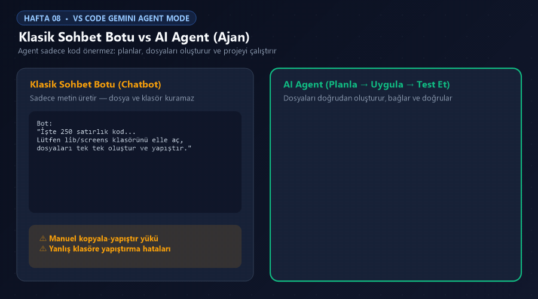
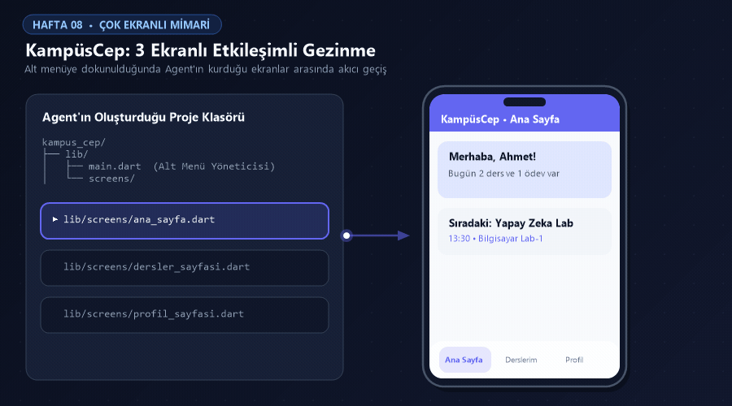
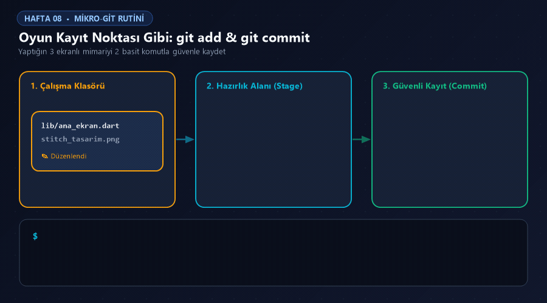

# 🤖 Hafta 08: Yapay Zekâ Ajanı (Agent Mode) ile 3 Ekranlı Uygulama

> Geçen hafta tek ekranlı bir uygulama yaptık. Gerçek uygulamalarda ise birden fazla ekran ve bu ekranlar arasında geçiş yapan bir **alt menü** bulunur. Bu hafta önce **klasör, dosya, ekran geçişi ve yapay zekâ ajanı** kavramlarını öğrenecek, sonra Google Stitch ile 2 yeni ekran tasarlayıp VS Code Gemini'nin **Agent Mode** özelliğiyle uygulamamızı 3 ekranlı hâle getireceğiz.



---

## 🗺️ Bu Hafta Ne Yapacağız?

| Bölüm | Ne Yapacağız? | Süre |
|---|---|---|
| **Bölüm 1** | Kavramlar: klasör/dosya, `lib/screens`, ekran geçişi, alt menü, sohbet botu vs ajan, plan | 30 dk |
| **Bölüm 2** | Adım adım: Stitch'te 2 ekran → Agent Mode'u aç → Plan iste → Onayla → Çalıştır | 70 dk |
| **Bölüm 3** | İlk kayıt noktamız: `git add` ve `git commit` | 10 dk |

> 🎯 **Hafta sonunda elinde olacaklar:** Alttaki menüyle birbirine geçiş yapan **3 ekranlı** çalışan bir uygulama ve projenin **ilk Git kaydı**.

---

## 📖 BÖLÜM 1 — Önce Kavramları Öğrenelim

### 1.1 Klasör, Dosya ve Dosya Uzantısı
- **Basit Tanım:** **Dosya**, içinde bilgi saklanan tek bir belgedir. **Klasör**, dosyaları gruplayan kutudur. **Uzantı**, dosya adının sonundaki noktadan sonraki kısımdır ve dosyanın türünü söyler.
- **Benzetme:** Klasör bir **çekmece**, dosya çekmecedeki **defter**dir.
- **Bizim Projede:**

| Uzantı | Anlamı |
|---|---|
| `.dart` | Flutter kod dosyası |
| `.png` | Resim dosyası (Stitch tasarımlarımız) |
| `.md` | Not/doküman dosyası (Markdown) |

### 1.2 Proje Klasör Yapısı: `lib` ve `lib/screens`
- **Basit Tanım:** Flutter projelerinde tüm kod dosyaları **`lib`** klasöründe durur. Ekranları düzenli tutmak için `lib` içinde **`screens`** (ekranlar) adında bir alt klasör açarız.
- **Benzetme:** Tüm kıyafetleri tek çekmeceye tıkıştırmak yerine "tişörtler", "pantolonlar" diye ayırmak gibi.
- **Bizim Projede (bu haftanın sonunda):**
```text
lib/
├── main.dart              ← Uygulamanın giriş kapısı + alt menü
└── screens/
    ├── ana_sayfa.dart     ← 1. ekran
    ├── dersler_sayfasi.dart ← 2. ekran
    └── profil_sayfasi.dart  ← 3. ekran
```

> 💡 **Neden tek dosya yetmez?** Her şey tek dosyada olursa dosya yüzlerce satıra çıkar; hata bulmak ve değişiklik yapmak zorlaşır. Ayrı dosyalar = düzenli proje.

### 1.3 `main.dart` Ne İş Yapar?
- **Basit Tanım:** Uygulama açıldığında **ilk çalışan** dosyadır.
- **Benzetme:** Bir binanın **giriş kapısı ve danışma masası**. Gelen kişiyi doğru odaya (ekrana) yönlendirir.
- **Bizim Projede:** `main.dart` sadece uygulamanın rengini/temasını ve alt menüyü yönetecek; ekranların içeriği `screens` klasöründe olacak.

### 1.4 Ekran Geçişi (Navigasyon) ve Alt Menü
- **Basit Tanım:** **Navigasyon**, bir ekrandan diğerine geçmektir. **Alt Menü (Bottom Navigation Bar)**, ekranın en altındaki sekmelerdir; dokununca ilgili ekran açılır.
- **Benzetme:** Bir AVM'deki **kat yönlendirme panosu** gibi; hangi kata (ekrana) gitmek istiyorsan ona basarsın.
- **Bizim Projede:** 3 sekme: **Ana Sayfa • Derslerim • Profil**.



### 1.5 Sohbet Botu ve Yapay Zekâ Ajanı (Agent) Arasındaki Fark
- **Sohbet Botu:** Sadece **cevap yazar**. Kodu sen kopyalayıp doğru dosyaya yapıştırırsın.
- **Ajan (Agent):** Proje klasörünü **görür**, **yeni dosya ve klasör oluşturur**, birden fazla dosyayı aynı anda **düzenler** ve gerekirse komut çalıştırır.
- **Benzetme:** Sohbet botu, telefonda tarif veren bir **danışman**dır. Ajan ise evine gelip işi bizzat yapan bir **usta**dır — ama her işe başlamadan önce senden **izin** ister.

| Özellik | Sohbet Botu | Agent Mode |
|---|---|---|
| Proje dosyalarını görür mü? | ❌ | ✅ |
| Yeni dosya oluşturur mu? | ❌ (sen yaparsın) | ✅ (onayınla) |
| Birden çok dosyayı birlikte düzenler mi? | ❌ | ✅ |
| Kontrol kimde? | Sende | Yine sende — her değişikliği onaylarsın |

### 1.6 Plan → Onay → Uygulama Yöntemi
- **Basit Tanım:** Ajana doğrudan "yap" demek yerine önce **ne yapacağını listelemesini** isteriz, listeyi kontrol eder, sonra onay veririz.
- **Benzetme:** Usta evi boyamaya başlamadan önce "Hangi odayı hangi renge boyayacağım?" listesini sana gösterir; sen onaylarsın.
- **Neden önemli?** Ajan bazen istemediğin dosyaları da değiştirebilir. Plan sayesinde sürprizleri önceden yakalarsın.

### 1.7 Tasarım Tutarlılığı
- **Basit Tanım:** Uygulamadaki tüm ekranların aynı renkleri, yazı boyutlarını ve kart şekillerini kullanmasıdır.
- **Benzetme:** Bir okulun tüm öğrencilerinin aynı formayı giymesi gibi — bakınca aynı okuldan olduklarını anlarsın.
- **Bizim Projede:** Yeni ekranları **Hafta 07'deki aynı Stitch projesinde** tasarlayacağız; böylece renkler otomatik aynı kalır.

### 1.8 Git: Kayıt Almak (`add` ve `commit`)
- **Basit Tanım:** Git'te kayıt almak 2 adımdır: **`git add`** ile kaydedilecek dosyaları seçeriz, **`git commit`** ile kaydı açıklamasıyla birlikte mühürleriz.
- **Benzetme:** Kargo göndermek gibi: Önce eşyaları **kutuya koyarsın** (`add`), sonra kutuyu **kapatıp üzerine etiket yazarsın** (`commit`).

### 📌 Kavram Özet Tablosu

| Kavram | Tek Cümlelik Hatırlatma |
|---|---|
| `lib/screens` | Ekran dosyalarının tutulduğu düzenli klasör |
| `main.dart` | Uygulamanın giriş kapısı ve alt menü yöneticisi |
| Navigasyon | Ekranlar arası geçiş |
| Alt Menü | En alttaki sekmeler |
| Agent Mode | Dosya oluşturup düzenleyebilen yapay zekâ ustası |
| Plan → Onay → Uygula | Ajana önce plan yaptırıp sonra onay vermek |
| `git add` / `git commit` | Kutuya koy / kutuyu etiketleyip mühürle |

---

## 🛠️ BÖLÜM 2 — Adım Adım: 3 Ekranlı Uygulamayı AI ile Üretelim

### ▶️ Adım 1: Google Stitch'te 2. ve 3. Ekranı Tasarla
**Ne yapıyoruz?** Mimarımızdan yeni iki odanın çizimini istiyoruz.

1. [stitch.withgoogle.com](https://stitch.withgoogle.com) adresinde **Hafta 07'deki aynı projeni** aç (yeni proje açma — renkler değişebilir).
2. **2. Ekran** için yaz (kendi projene göre uyarla):
```text
Add a second screen to the same app with the exact same style and colors.
Screen name: "Derslerim" (Turkish UI).
Elements: Day filter chips at the top ("Pzt", "Sal", "Çar", "Per", "Cum"), a vertical list of colorful course cards (course name, time, classroom), same bottom navigation with "Derslerim" selected.
```
3. **3. Ekran** için yaz:
```text
Add a third screen to the same app with the exact same style and colors.
Screen name: "Profil" (Turkish UI).
Elements: Round student avatar, name "Zeynep Yılmaz", department "Bilgisayar Programcılığı", settings rows ("Bildirimler", "Tema", "Hakkında"), same bottom navigation with "Profil" selected.
```
4. Her iki ekranı da PNG olarak indir ve `tasarimlar/` klasörüne kaydet:
   - `tasarimlar/ekran2_stitch.png`
   - `tasarimlar/profil_stitch.png`

✔️ **Kontrol:** `tasarimlar/` klasöründe 3 görsel var mı (`ana_ekran`, `ekran2`, `profil`)? Üçü de aynı renkleri kullanıyor mu?

### ▶️ Adım 2: VS Code'da Agent Mode'u Aç
**Ne yapıyoruz?** Gemini'yi "danışman" modundan "usta" moduna geçiriyoruz.

1. VS Code'da sol menüden **✦ Gemini** panelini aç.
2. Sohbet kutusunun yakınındaki **Agent** düğmesini/anahtarını aktif et.
3. Bundan sonra Gemini bir dosyayı değiştirmek veya oluşturmak istediğinde sana **Accept / Approve (Onayla)** ve **Reject (Reddet)** seçenekleri gösterecek.

✔️ **Kontrol:** Agent modu açık görünüyor mu?

### ▶️ Adım 3: Ajandan Önce PLAN İste
**Ne yapıyoruz?** Ajan işe başlamadan ne yapacağını görmek istiyoruz.

Sohbet kutusunda `@tasarimlar/ekran2_stitch.png` ve `@tasarimlar/profil_stitch.png` dosyalarını ekle ve gönder:

```text
Projemizi tek ekrandan 3 ekranlı bir uygulamaya dönüştürmek istiyorum.

ŞİMDİLİK KOD YAZMA, SADECE PLAN YAP:
1. lib/screens/ klasörü altında 3 ekran dosyası olsun:
   - ana_sayfa.dart (şu anki ana ekranımız)
   - dersler_sayfasi.dart (@tasarimlar/ekran2_stitch.png tasarımına uygun)
   - profil_sayfasi.dart (@tasarimlar/profil_stitch.png tasarımına uygun)
2. lib/main.dart sadece temayı ve alttaki 3 sekmeli menüyü yönetsin.
3. Seçili sekme ana rengimizle vurgulansın.
4. Tüm yazılar Türkçe kalsın.

Bana oluşturacağın dosya listesini ve yapacağın adımları kısa ve sade Türkçe maddelerle göster.
```

✔️ **Kontrol:** Ajan sana dosya listesini ve adımları gösterdi mi? Listede 3 ekran dosyası ve `main.dart` var mı?

### ▶️ Adım 4: Planı Kontrol Et ve Onayla
**Ne yapıyoruz?** Planı gözden geçirip "tamam, başla" diyoruz.

1. Planda istemediğin bir şey varsa düzelt. Örnek: *"Profil ekranında şifre değiştirme olmasın."*
2. Plan uygunsa gönder:
```text
Plan uygun, onaylıyorum. Şimdi dosyaları oluştur. İşin bitince ne yaptığını 3 maddeyle açıkla.
```
3. Ajan her dosya için onay isteyecek. Önerilen değişikliğe bakıp **Accept / Approve** düğmesine bas.

✔️ **Kontrol:** Explorer'da `lib/screens/` klasörü ve içinde 3 `.dart` dosyası oluştu mu?

### ▶️ Adım 5: Çalıştır ve Test Et
**Ne yapıyoruz?** Ekranlar arası geçişin çalıştığını doğruluyoruz.

1. Sağ alttan **Chrome** veya emülatör seç, **`F5`** tuşuna bas.
2. Alt menüdeki 3 sekmeye sırayla dokun.

✔️ **Kontrol:**
- [ ] Her sekme farklı bir ekran açıyor.
- [ ] Seçili sekme renkli görünüyor.
- [ ] 3 ekran da Stitch tasarımlarına benziyor ve yazılar Türkçe.

### ▶️ Adım 6: Fark Varsa Konuşarak Düzelt
Örnek düzeltme prompt'ları:
```text
Derslerim ekranındaki gün çipleri tasarımda üstte yan yana duruyor, uygulamada alt alta çıkmış. Tasarımdaki gibi düzelt.
```
```text
Alt menüde sekmeye tıklayınca ekran değişmiyor. Sorunu bul, düzelt ve nedenini 2 cümleyle açıkla.
```

---

## 🌱 BÖLÜM 3 — Mikro-Git: İlk Kayıt Noktamız

**Hatırlatma (Kavram 1.8):** `git add` = kutuya koy, `git commit` = etiketle ve mühürle.



**İlk kez yapıyorsan** Git'e kim olduğunu söyle (sadece 1 kez, kendi bilgilerinle):
```bash
git config --global user.name "Adın Soyadın"
git config --global user.email "eposta@ornek.com"
```

Sonra kayıt al:
```bash
git add .
git commit -m "Hafta 8: 3 ekranli yapi ve alt menu eklendi"
```

| Parça | Anlamı |
|---|---|
| `git add .` | Değişen **tüm** dosyaları kutuya koy (`.` = "hepsi") |
| `git commit -m "..."` | Kutuyu mühürle; `-m` sonrasındaki tırnak içi yazı kaydın **açıklamasıdır** |

✔️ **Kontrol:** Şimdi `git status` yaz. *"nothing to commit, working tree clean"* (kaydedilecek bir şey yok, her şey temiz) yazısını görüyorsan kayıt başarılı!

> 💡 **İyi açıklama nasıl yazılır?** "değişiklik" gibi belirsiz değil, **ne yaptığını** anlatan kısa cümle yaz: *"Hafta 8: Profil ekranı eklendi"*.

---

## ⚠️ Sık Karşılaşılan Sorunlar

| Sorun | Neden? | Ne Yapmalı? |
|---|---|---|
| Ajan her şeyi yine `main.dart`'a yazdı | Klasör yapısı net söylenmedi | *"Ekranları lib/screens/ altında ayrı dosyalara böl"* yaz |
| Ajan plan yerine direkt kod yazdı | "Kod yazma" uyarısı atlandı | **Reject** de, prompt'a *"ŞİMDİLİK KOD YAZMA, SADECE PLAN YAP"* ekleyip tekrar gönder |
| Yeni ekranların renkleri farklı | Stitch'te yeni proje açıldı | Aynı Stitch projesinde tekrar tasarla |
| `git commit` "Please tell me who you are" hatası verdi | Git kimliği tanımlanmamış | `git config --global user.name/user.email` komutlarını çalıştır |

---

## 📝 Haftalık Ödev

1. Stitch'te kendi projenin 2. ve 3. ekranını aynı stilde tasarla, `tasarimlar/` klasörüne kaydet.
2. Agent Mode ile **Plan → Onay → Uygula** yöntemini kullanarak 3 ekranlı yapıyı kur.
3. Alt menüdeki tüm sekmeleri test et.
4. `git add .` ve `git commit` ile ilk kaydını al.

### ✅ Hafta 08 Kontrol Listesi
- [ ] `lib/screens` klasörünün ve `main.dart` dosyasının görevini anlatabiliyorum.
- [ ] Sohbet botu ile ajan arasındaki farkı biliyorum.
- [ ] Stitch'te 2 yeni ekranı aynı stilde tasarladım.
- [ ] Ajana önce plan yaptırdım, sonra onaylayıp uygulattım.
- [ ] Uygulamam 3 ekranlı ve alt menüyle çalışıyor.
- [ ] `git add` ve `git commit` ile ilk kaydımı aldım.

---

### 🔗 Ders Navigasyonu
⬅️ [Hafta 07: Stitch → VS Code Gemini](../Hafta-07/README.md) | 🏠 [Ana Sayfa](../README.md) | ➡️ [Hafta 09: Proje Kuralları, Skills & GitHub](../Hafta-09/README.md)
