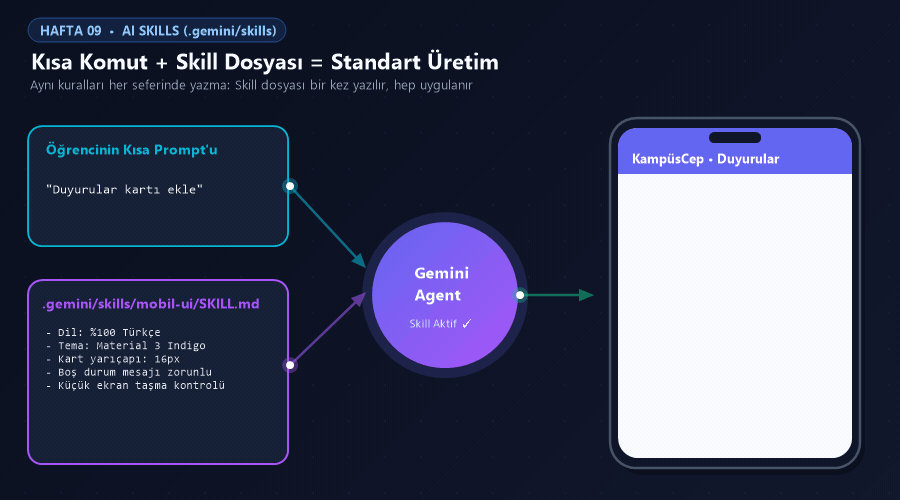
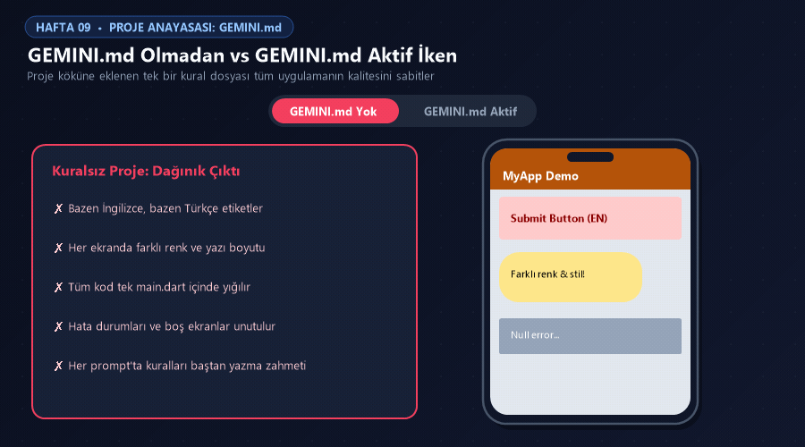
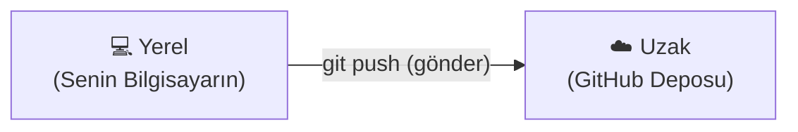

# 🧠 Hafta 09: Yapay Zekâya Kurallarımızı Öğretmek (`GEMINI.md` & Skills) ve İlk GitHub Yedeği

> Son iki haftada her prompt'un sonuna *"Türkçe olsun, şu renkleri kullan, taşma olmasın..."* yazmak zorunda kaldık. Bu hafta önce **kural dosyası, Markdown, Skill, bulut, GitHub ve depo** kavramlarını öğreneceğiz. Sonra yapay zekâya kurallarımızı **tek seferde** öğretecek, Stitch tasarımından yeni bir bölümü kısa bir komutla ürettirecek ve projemizi ilk kez **GitHub**'a yedekleyeceğiz.



---

## 🗺️ Bu Hafta Ne Yapacağız?

| Bölüm | Ne Yapacağız? | Süre |
|---|---|---|
| **Bölüm 1** | Kavramlar: Markdown, `GEMINI.md`, Skill, gizli klasör, bulut, GitHub, depo, `push` | 30 dk |
| **Bölüm 2** | Adım adım: `GEMINI.md` oluştur → Skill oluştur → Stitch'te yeni bölüm tasarla → Kısa prompt ile ürettir | 50 dk |
| **Bölüm 3** | GitHub hesabı aç → Depo oluştur → Projeyi gönder (`push`) | 30 dk |

> 🎯 **Hafta sonunda elinde olacaklar:** Proje kurallarını içeren `GEMINI.md`, kendi yazdığın bir yapay zekâ **Skill**'i, kısa prompt'la eklenmiş yeni bir bölüm ve **GitHub'da yayında olan projen**.

---

## 📖 BÖLÜM 1 — Önce Kavramları Öğrenelim

### 1.1 Markdown (`.md`) Dosyası
- **Basit Tanım:** Basit işaretlerle biçimlendirilmiş düz metin dosyasıdır. Şu an okuduğun doküman da bir Markdown dosyasıdır.
- **Benzetme:** Word belgesinin sade, herkesin (insanların ve yapay zekânın) kolayca okuyabildiği hâli.
- **Bilmen gereken 3 işaret:**

| Yazış | Görünüş |
|---|---|
| `# Başlık` | Büyük başlık |
| `- madde` | Madde işaretli liste |
| `**kalın**` | **kalın** yazı |

### 1.2 Proje Kuralları Dosyası: `GEMINI.md`
- **Basit Tanım:** Projenin ana klasörüne koyduğumuz, yapay zekânın **her işe başlamadan önce otomatik okuduğu** kurallar dosyasıdır.
- **Benzetme:** Yeni işe başlayan bir çalışana verilen **"Şirket Kuralları El Kitabı"**. Çalışan her sabah bu kitaba göre davranır; ona her gün kuralları tekrar anlatmana gerek kalmaz.
- **İçinde ne olur?** Uygulama adı, dil kuralı (Türkçe), renk kodları, köşe yuvarlaklığı, klasör düzeni gibi **her zaman geçerli** kurallar.



### 1.3 Skill (Yetenek) Nedir?
- **Basit Tanım:** Yapay zekâya **belirli bir işi nasıl yapacağını** adım adım anlatan tarif dosyasıdır. Dosyanın adı her zaman `SKILL.md` olur.
- **Benzetme:** `GEMINI.md` şirketin genel kurallarıysa, Skill bir **yemek tarifidir**: "Stitch tasarımını koda çevirmek istediğinde şu 6 adımı uygula."
- **Farkı:**

| | `GEMINI.md` | Skill (`SKILL.md`) |
|---|---|---|
| Ne zaman kullanılır? | **Her zaman** | Sadece o işle ilgili bir istek geldiğinde |
| Neyi anlatır? | Genel kurallar | Belirli bir işin adımları |
| Kaç tane olur? | Projede 1 tane | İstediğin kadar |

### 1.4 Gizli Klasör: `.gemini/skills/`
- **Basit Tanım:** Adı **nokta (`.`)** ile başlayan klasörler "ayar klasörü" kabul edilir. Skill'lerimizi **`.gemini/skills/`** klasörüne koyarız; Gemini bu klasöre bakıp yeteneklerini tanır.
- **Benzetme:** Mutfaktaki **tarif kutusu**. Usta (Gemini) yemek yaparken önce bu kutuya bakar.
- **Klasör yapısı:**
```text
proje-klasorun/
├── GEMINI.md                          ← Genel kurallar
└── .gemini/
    └── skills/
        └── stitch-to-flutter/
            └── SKILL.md               ← Stitch → Flutter tarifi
```

### 1.5 Bulut, GitHub ve Depo (Repository)
- **Bulut:** Dosyalarının kendi bilgisayarında değil, internetteki güvenli bir sunucuda saklanmasıdır (Google Drive gibi).
- **GitHub:** Yazılımcıların projelerini bulutta sakladığı ve paylaştığı ücretsiz sitedir. Aynı zamanda bir **yazılımcı vitrini (portfolyo)**dur; işverenler projelerine buradan bakar.
- **Depo (Repository / Repo):** GitHub'daki **tek bir proje klasörüdür**.
- **Benzetme:** GitHub bir **kütüphane**, depo ise kütüphanedeki **senin rafındır**.

### 1.6 Yerel (Local) ve Uzak (Remote)
- **Yerel:** Kendi bilgisayarındaki proje.
- **Uzak (remote / origin):** GitHub'daki kopyası.
- **`git push`:** Yereldeki kayıtlarını uzağa (GitHub'a) **gönderir**.
- **Benzetme:** Telefonundaki fotoğrafları Google Fotoğraflar'a **yedeklemek**.



### 📌 Kavram Özet Tablosu

| Kavram | Tek Cümlelik Hatırlatma |
|---|---|
| Markdown | `#`, `-`, `**` işaretleriyle biçimlenen sade metin |
| `GEMINI.md` | Yapay zekânın her seferinde okuduğu kurallar kitabı |
| Skill | Belirli bir işin adım adım tarifi (`SKILL.md`) |
| `.gemini/skills/` | Skill'lerin durduğu tarif kutusu |
| GitHub | Projelerin bulutta saklandığı yazılımcı vitrini |
| Depo (Repo) | GitHub'daki tek proje klasörü |
| `git push` | Kayıtları GitHub'a gönder |

---

## 🛠️ BÖLÜM 2 — Adım Adım: Kurallarımızı AI'ya Öğretelim

### ▶️ Adım 1: `GEMINI.md` Dosyasını Oluştur
**Ne yapıyoruz?** Yapay zekâya şirket kurallarımızı yazıyoruz.

1. VS Code Explorer'da **proje ana klasörüne** (en üst seviye, `lib` klasörünün yanına) sağ tıkla → **New File** → adını **`GEMINI.md`** koy.
2. [ornek-sablonlar/GEMINI.md](ornek-sablonlar/GEMINI.md) dosyasındaki içeriği kopyalayıp yapıştır.
3. Kendi projene göre şunları değiştir:
   - **Uygulama adı** (örn. Kitaplığım)
   - **Renk kodları** → Stitch tasarımındaki renkleri kullan *(Stitch'te bir renge tıklayınca `#` ile başlayan kodu görebilirsin)*
4. Dosyayı kaydet (`Ctrl + S`).

✔️ **Kontrol:** `GEMINI.md` dosyası `lib` klasörüyle **aynı seviyede** mi? (İçinde değil, yanında olmalı.)

### ▶️ Adım 2: İlk Skill'ini Oluştur
**Ne yapıyoruz?** "Stitch tasarımını koda çevirme" tarifini yazıyoruz.

1. Proje ana klasöründe sırayla şu klasörleri oluştur: **`.gemini`** → içinde **`skills`** → içinde **`stitch-to-flutter`**.
2. `stitch-to-flutter` klasörünün içinde **`SKILL.md`** dosyası oluştur.
3. [ornek-sablonlar/stitch-to-flutter-SKILL.md](ornek-sablonlar/stitch-to-flutter-SKILL.md) içeriğini kopyalayıp yapıştır ve kaydet.

> 🔍 **Skill dosyasının yapısı:** En üstte `---` çizgileri arasında **`name`** (yeteneğin adı) ve **`description`** (ne zaman kullanılacağı) yazar. Gemini bu açıklamayı okuyarak "Bu iş için bu tarifi kullanmalıyım" diye karar verir. Altında ise adım adım talimatlar bulunur.

✔️ **Kontrol:** Dosya yolu tam olarak `.gemini/skills/stitch-to-flutter/SKILL.md` mi?

### ▶️ Adım 3: Google Stitch'te Yeni Bir Bölüm Tasarla
**Ne yapıyoruz?** Kurallarımızı test etmek için mimardan yeni bir çizim istiyoruz.

1. Stitch'te **aynı projeni** aç ve ana sayfaya eklenecek bir bölüm tasarla (kendi projene uyarla):
```text
Design an "Duyurular" (Announcements) section for the same app, same style and colors (Turkish UI).
4 announcement cards, each with a small date badge, a bold title and a one-line summary.
```
2. PNG olarak indir → `tasarimlar/duyurular_stitch.png` adıyla kaydet.

✔️ **Kontrol:** Yeni görsel `tasarimlar/` klasöründe mi?

### ▶️ Adım 4: Kısa Prompt ile Test Et — Kuralların Gücünü Gör!
**Ne yapıyoruz?** Artık uzun kurallar yazmadan kısa bir istekte bulunuyoruz.

Agent Mode açıkken gönder:
```text
stitch-to-flutter yeteneğini kullanarak @tasarimlar/duyurular_stitch.png tasarımını ana sayfanın altına "Duyurular" bölümü olarak ekle.
```

Dikkat et: Bu prompt'ta **Türkçe, renk, taşma** gibi hiçbir kural yazmadık! Gemini bunları `GEMINI.md` ve `SKILL.md` dosyalarından okuyacak.

✔️ **Kontrol:** Uygulamayı `F5` ile çalıştır:
- [ ] Duyurular bölümü eklendi.
- [ ] Renkler `GEMINI.md`'deki renklerle aynı.
- [ ] Yazılar Türkçe, kartların köşeleri yuvarlak.
- [ ] Gemini işi bitirince 3 maddelik Türkçe özet verdi (bu kural Skill'den geliyor!).

---

## 🌱 BÖLÜM 3 — Mikro-Git: Projeyi GitHub'a Gönderelim

### ▶️ Adım 5: Önce Yerel Kaydı Al
```bash
git add .
git commit -m "Hafta 9: GEMINI.md, skill ve duyurular bolumu eklendi"
```

### ▶️ Adım 6: GitHub Hesabı ve Depo Oluştur
1. [github.com](https://github.com) adresine git → **Sign up** ile ücretsiz hesap aç (hesabın varsa **Sign in**).
2. Sağ üstteki **`+`** simgesine tıkla → **New repository**.
3. **Repository name** kutusuna proje adını yaz (örn. `kampus-cep`). Türkçe karakter ve boşluk kullanma.
4. **Public** seçili kalsın (portfolyonda görünsün).
5. ⚠️ "Add a README file" kutusunu **işaretleme** (projemizde dosyalar zaten var).
6. **Create repository** düğmesine bas.
7. Açılan sayfadaki `https://github.com/KULLANICI_ADIN/kampus-cep.git` adresini kopyala.

### ▶️ Adım 7: Bilgisayarını GitHub'a Bağla ve Gönder
VS Code terminalinde (adresi kendi adresinle değiştir):
```bash
git branch -M main
git remote add origin https://github.com/KULLANICI_ADIN/kampus-cep.git
git push -u origin main
```

| Komut | Anlamı | Kaç Kez? |
|---|---|---|
| `git branch -M main` | Ana kayıt hattımızın adını `main` yap | 1 kez |
| `git remote add origin ...` | "GitHub'daki bu adres benim uzak depom" de | 1 kez |
| `git push -u origin main` | Kayıtları GitHub'a gönder | İlk sefer böyle; sonra sadece `git push` |

> 🔐 İlk `push` sırasında bir pencere açılıp GitHub girişi isteyebilir. **"Sign in with your browser"** seçeneğine tıkla ve tarayıcıda onayla.

✔️ **Kontrol:** GitHub'daki depo sayfanı yenile. `lib`, `tasarimlar`, `GEMINI.md` ve `.gemini` klasörlerini görüyor musun? Görüyorsan **projen artık bulutta!** 🎉

Son olarak depo adresini `PROJE-KARTIM.md` dosyana yaz.

---

## ⚠️ Sık Karşılaşılan Sorunlar

| Sorun | Neden? | Ne Yapmalı? |
|---|---|---|
| Gemini renk/dil kurallarına uymadı | `GEMINI.md` yanlış yerde | Dosyanın `lib` ile **aynı seviyede** olduğundan emin ol |
| Skill kullanılmadı | Dosya yolu veya adı yanlış | Yolun `.gemini/skills/stitch-to-flutter/SKILL.md` olduğunu kontrol et |
| `remote origin already exists` hatası | Bağlantı daha önce eklenmiş | Sorun yok, doğrudan `git push -u origin main` yaz |
| `push` reddedildi (rejected) | GitHub'da README ile depo oluşturulmuş | Eğitmeninden yardım iste veya README'siz yeni depo aç |

---

## 📝 Haftalık Ödev

1. Projene özel `GEMINI.md` dosyası oluştur (uygulama adı + Stitch renk kodları).
2. `.gemini/skills/stitch-to-flutter/SKILL.md` dosyasını ekle.
3. Stitch'te yeni bir bölüm tasarla ve kısa prompt ile ürettir.
4. GitHub deposu oluştur, projeni `push` et ve adresi `PROJE-KARTIM.md` dosyana yaz.

### ✅ Hafta 09 Kontrol Listesi
- [ ] `GEMINI.md` ile Skill arasındaki farkı anlatabiliyorum.
- [ ] `GEMINI.md` dosyam doğru yerde ve kendi renklerimi içeriyor.
- [ ] `.gemini/skills/` içinde çalışan bir Skill'im var.
- [ ] Kısa bir prompt'la kurallara uygun yeni bölüm ürettirdim.
- [ ] Projem GitHub'da yayında.

---

### 🔗 Ders Navigasyonu
⬅️ [Hafta 08: Agent Mode & 3 Ekran](../Hafta-08/README.md) | 🏠 [Ana Sayfa](../README.md) | ➡️ [Hafta 10: Etkileşim ve Durum (State)](../Hafta-10/README.md)
