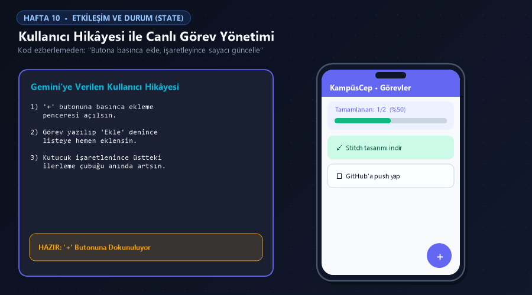
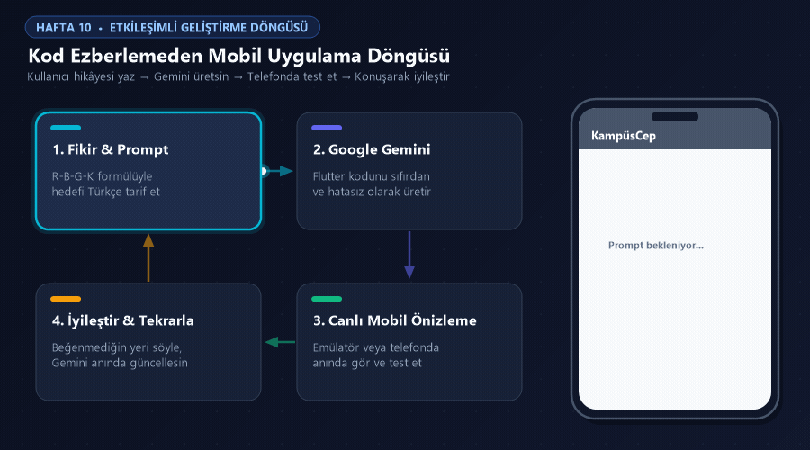

# ⚡ Hafta 10: Uygulamaya Hayat Verelim — Etkileşim, Form ve Durum (State)

> Uygulamamız güzel görünüyor ama henüz **sadece bir resim gibi**: butonlara basınca bir şey olmuyor, yeni bilgi ekleyemiyoruz. Bu hafta önce **etkileşim, durum (state), form, doğrulama ve kullanıcı hikâyesi** kavramlarını öğreneceğiz. Sonra Google Stitch ile ekleme penceresini tasarlayıp, Gemini'ye **kod yerine kullanıcı hikâyeleri** anlatarak uygulamamızı canlı hâle getireceğiz.



---

## 🗺️ Bu Hafta Ne Yapacağız?

| Bölüm | Ne Yapacağız? | Süre |
|---|---|---|
| **Bölüm 1** | Kavramlar: etkileşim, durum (state), form, doğrulama, alt pencere, boş durum, kullanıcı hikâyesi | 30 dk |
| **Bölüm 2** | Adım adım: Hikâyeleri yaz → Stitch'te tasarla → Gemini'ye plan + uygulama → Senaryoları test et | 70 dk |
| **Bölüm 3** | Geçmişi ve değişiklikleri okuma: `git diff`, `git log` | 10 dk |

> 🎯 **Hafta sonunda elinde olacaklar:** Kullanıcının **ekleyip, işaretleyip, filtreleyip, silebildiği** canlı bir liste ekranı.

---

## 📖 BÖLÜM 1 — Önce Kavramları Öğrenelim

### 1.1 Etkileşim
- **Basit Tanım:** Kullanıcının uygulamaya bir şey yapması (dokunma, yazı yazma, kaydırma) ve uygulamanın buna **tepki vermesidir**.
- **Benzetme:** Asansör düğmesine basınca ışığın yanması ve asansörün gelmesi.
- **Bizim Projede:** `+` düğmesine basınca ekleme penceresinin açılması.

### 1.2 Durum (State) Nedir?
- **Basit Tanım:** Uygulamanın **o anda hatırladığı bilgilerdir** (listede kaç görev var, hangileri tamamlandı, hangi filtre seçili). Durum değişince ekran **kendiliğinden güncellenir**.
- **Benzetme:** Bir maçtaki **skor tabelası**. Gol atılınca (olay) skor değişir (durum) ve tabela hemen yeni skoru gösterir (ekran güncellenir).
- **Bizim Projede:**

| Olay (Kullanıcı ne yaptı?) | Değişen Durum | Ekranda Ne Değişir? |
|---|---|---|
| Yeni görev ekledi | Görev listesi 1 arttı | Listeye yeni kart eklenir, sayaç artar |
| Kutucuğu işaretledi | Görev "tamamlandı" oldu | Kartın üstü çizilir, ilerleme çubuğu dolar |
| "Bekleyen" filtresine bastı | Seçili filtre değişti | Sadece bekleyen görevler görünür |

> 💡 Hafta 1-6'da öğrendiğimiz **List** (liste) ve **değişken** kavramları burada çalışıyor: Görevler aslında bir **liste** içinde tutulur; ekleme = `add`, silme = `remove`.

### 1.3 Form, Giriş Kutusu ve Doğrulama
- **Form:** Kullanıcıdan bilgi aldığımız alanların tamamı.
- **Giriş Kutusu (Text Field):** Kullanıcının yazı yazdığı kutu.
- **Doğrulama (Validation):** Girilen bilginin **uygun olup olmadığını kontrol etmek** (örn. boş bırakılmış mı?).
- **Benzetme:** Kargo şubesinde görevlinin "Adres kısmını boş bırakmışsınız" diyerek formu geri vermesi.

### 1.4 Alt Pencere (Bottom Sheet) ve Yüzen Düğme (FAB)
- **Alt Pencere:** Ekranın altından yukarı kayarak açılan küçük penceredir.
- **FAB (Yüzen Eylem Düğmesi):** Ekranın sağ altında duran yuvarlak `+` düğmesidir.
- **Bizim Projede:** `+` (FAB) → Alt pencere açılır → Görev yazılır → Kaydet.

### 1.5 Filtreleme, Kaydırarak Silme ve Geri Al
- **Filtreleme:** Listenin sadece belirli kısmını göstermek (Tümü / Bekleyen / Tamamlanan). Hafta 5'teki liste filtrelemenin ekrandaki karşılığıdır!
- **Kaydırarak Silme (Swipe):** Kartı parmakla yana kaydırınca silinmesi.
- **Geri Al (Undo):** Yanlışlıkla silinen öğeyi geri getirme. Ekranın altında kısa süre görünen bildirim kutusuna **SnackBar** denir.

### 1.6 Boş Durum (Empty State)
- **Basit Tanım:** Listede hiç öğe yokken bomboş beyaz ekran yerine gösterilen bilgilendirici görünümdür.
- **Benzetme:** Boş bir dükkânda "Yakında yeni ürünler!" yazan şık bir tabela.
- **Örnek:** 🎉 ikonu + *"Harika! Tüm görevlerin bitti."*

### 1.7 Kullanıcı Hikâyesi (User Story)
- **Basit Tanım:** Uygulamanın nasıl davranması gerektiğini **kod yerine günlük dille** anlatan cümlelerdir. Kalıbı: **"Kullanıcı ... yaptığında, ekranda ... olmalı."**
- **Benzetme:** Bir tiyatro **senaryosu**: "Oyuncu kapıyı açtığında ışıklar yanar."
- **Neden kullanıyoruz?** Biz kod bilmiyoruz ama **ne olması gerektiğini** biliyoruz. Gemini bu hikâyeleri koda çevirir.

### 📌 Kavram Özet Tablosu

| Kavram | Tek Cümlelik Hatırlatma |
|---|---|
| Etkileşim | Kullanıcı bir şey yapar, uygulama tepki verir |
| Durum (State) | Uygulamanın o an hatırladığı bilgi (skor tabelası) |
| Doğrulama | Girilen bilgiyi kontrol etme |
| Alt Pencere / FAB | Alttan açılan pencere / sağ alttaki `+` düğmesi |
| Filtreleme | Listenin bir kısmını gösterme |
| SnackBar | Altta kısa süre görünen bildirim (Geri Al) |
| Boş Durum | Liste boşken gösterilen bilgilendirici ekran |
| Kullanıcı Hikâyesi | "Kullanıcı ... yaptığında ... olmalı" cümlesi |

---

## 🛠️ BÖLÜM 2 — Adım Adım: Etkileşimli Ekranı AI ile Üretelim

### ▶️ Adım 1: Kullanıcı Hikâyelerini Yaz
**Ne yapıyoruz?** Kod yazmadan önce uygulamanın nasıl davranacağını kâğıda döküyoruz.

Aşağıdaki tabloyu kendi projene göre uyarla (örn. Kitaplığım için "görev" yerine "kitap"):

| # | Kullanıcı Ne Yapar? | Ekranda Ne Olmalı? |
|---|---|---|
| 1 | Sağ alttaki **`+`** düğmesine dokunur | Alttan **"Yeni Görev Ekle"** penceresi açılır |
| 2 | Kutuyu boş bırakıp **Kaydet**'e basar | Kırmızı uyarı: *"Lütfen bir görev yazın!"* |
| 3 | Görev yazıp **Kaydet**'e basar | Pencere kapanır, görev listenin başına eklenir, sayaç artar |
| 4 | Görevin kutucuğunu işaretler | Görevin üstü çizilir, ilerleme çubuğu dolar |
| 5 | **Bekleyen / Tamamlanan** filtresine basar | Liste sadece o görevleri gösterir |
| 6 | Görev kartını sola kaydırır | Görev silinir, altta **"Geri Al"** bildirimi çıkar |
| 7 | Listede hiç görev kalmaz | *"Harika! Tüm görevlerin bitti 🎉"* mesajı görünür |

✔️ **Kontrol:** En az 6 hikâye yazdın mı? Her biri "ne yapar → ne olmalı" kalıbında mı?



### ▶️ Adım 2: Google Stitch'te Ekranı ve Ekleme Penceresini Tasarla
**Ne yapıyoruz?** Mimardan etkileşimli ekranın 3 hâlini istiyoruz: dolu liste, ekleme penceresi ve boş durum.

Stitch'te **aynı projeni** aç ve yaz:
```text
Add an interactive "Görevlerim" screen to the same app (same colors, 16px rounded cards, Turkish UI):
1. Top progress card: "Bugünkü İlerleme: 2/5 (%40)" with a green progress bar.
2. Filter chips: "Tümü", "Bekleyen", "Tamamlanan".
3. Task cards with a checkbox, title and a small tag badge. A round "+" button at bottom right.
Also create:
- A bottom sheet popup "Yeni Görev Ekle" with a text field and a full-width "Kaydet" button.
- An empty state version with a friendly icon and the text "Harika! Tüm görevlerin bitti".
```
3 görseli de `tasarimlar/` klasörüne kaydet:
- `tasarimlar/gorevler_stitch.png`
- `tasarimlar/ekle_penceresi_stitch.png`
- `tasarimlar/bos_durum_stitch.png`

✔️ **Kontrol:** 3 görsel de aynı renkleri kullanıyor mu?

### ▶️ Adım 3: Gemini'den Plan İste
**Ne yapıyoruz?** Ajana hikâyeleri ve tasarımları verip önce planını görüyoruz.

Agent Mode açıkken, 3 görseli `@` ile ekleyip gönder:
```text
@tasarimlar/gorevler_stitch.png @tasarimlar/ekle_penceresi_stitch.png @tasarimlar/bos_durum_stitch.png tasarımlarına uygun, etkileşimli bir "Görevlerim" ekranı yapmak istiyorum.

Kullanıcı hikâyeleri:
1. "+" düğmesine dokununca alttan "Yeni Görev Ekle" penceresi açılsın.
2. Kutu boşken Kaydet'e basılırsa "Lütfen bir görev yazın!" uyarısı çıksın.
3. Görev kaydedilince pencere kapansın, görev listenin başına eklensin, sayaç güncellensin.
4. Kutucuk işaretlenince görevin üstü çizilsin ve ilerleme çubuğu güncellensin.
5. "Tümü / Bekleyen / Tamamlanan" filtreleri listeyi anında süzsün.
6. Kart sola kaydırılınca silinsin ve altta "Geri Al" düğmeli bildirim çıksın.
7. Liste boşken boş durum görünümü gösterilsin.
8. Klavye açılınca ekleme penceresi klavyenin altında kalmasın.

ŞİMDİLİK KOD YAZMA. Önce hangi dosyaları oluşturup değiştireceğini sade Türkçe maddelerle planla.
```

✔️ **Kontrol:** Plan, 8 hikâyenin hepsini kapsıyor mu? Eksik varsa *"5. hikâyeyi planda göremedim, ekle"* yaz.

### ▶️ Adım 4: Onayla ve Uygulat
```text
Plan uygun, onaylıyorum. Şimdi uygula. Bitince hangi hikâyeyi hangi dosyada çözdüğünü kısa bir tabloyla göster.
```
Her dosya değişikliğini **Accept** ile onayla.

### ▶️ Adım 5: Her Hikâyeyi Tek Tek Test Et
**Ne yapıyoruz?** Bir kalite kontrolcü gibi her senaryoyu deniyoruz. `F5` ile çalıştır ve tabloyu doldur:

| # | Test | Çalıştı mı? |
|---|---|---|
| 1 | `+` düğmesi pencereyi açıyor | ☐ |
| 2 | Boş kayıtta uyarı çıkıyor | ☐ |
| 3 | Yeni görev listeye ekleniyor, sayaç artıyor | ☐ |
| 4 | İşaretleyince üstü çiziliyor, çubuk doluyor | ☐ |
| 5 | Filtreler doğru çalışıyor | ☐ |
| 6 | Kaydırınca siliniyor, "Geri Al" geri getiriyor | ☐ |
| 7 | Hepsi silinince boş durum görünüyor | ☐ |

### ▶️ Adım 6: Çalışmayan Hikâyeyi Düzelttir
Çalışmayan madde için hikâye numarasıyla net yaz:
```text
6. hikâye çalışmıyor: Kartı kaydırıp sildikten sonra "Geri Al"a basınca görev geri gelmiyor. Sorunu bul, düzelt ve nedenini 2 sade cümleyle açıkla.
```

> ⚠️ **Önemli:** Bu hafta eklediğimiz görevler, uygulama **kapatılınca kaybolur**. Bu normal! Çünkü durum (state) şimdilik sadece uygulamanın geçici hafızasında. Kalıcı hafızayı **Hafta 11**'de ekleyeceğiz.

---

## 🌱 BÖLÜM 3 — Mikro-Git: Değişiklikleri ve Geçmişi Okumak

**Yeni kavramlar:**
- **`git diff`:** Son kayıttan bu yana **hangi satırların değiştiğini** gösterir. Yeşil `+` = eklenen satır, kırmızı `-` = silinen satır.
- **`git log --oneline`:** Şimdiye kadarki **tüm kayıtları** tek satırlık özetlerle listeler.
- **Benzetme:** `diff` → bir yazının "değişiklikleri izle" görünümü. `log` → defterin içindekiler sayfası.

```bash
git diff
```
> Uzun çıktıda aşağı inmek için `Space` (boşluk), çıkmak için **`q`** tuşuna bas.

Ardından kaydet ve gönder:
```bash
git add .
git commit -m "Hafta 10: Etkilesimli gorev listesi, filtre ve geri al eklendi"
git push
git log --oneline
```

✔️ **Kontrol:** `git log --oneline` çıktısında Hafta 8, 9 ve 10 kayıtlarını alt alta görüyor musun?

---

## ⚠️ Sık Karşılaşılan Sorunlar

| Sorun | Neden? | Ne Yapmalı? |
|---|---|---|
| Ekleme penceresi klavyenin altında kalıyor | Klavye boşluğu hesaplanmamış | *"Klavye açılınca pencere yukarı kaysın"* yaz |
| Görev eklenince sayaç değişmiyor | Durum güncellemesi eksik | *"3. hikâye: Görev eklenince sayaç güncellenmiyor, düzelt"* yaz |
| Uygulama kapanınca görevler siliniyor | Henüz kalıcı hafıza yok | Normal — Hafta 11'de çözeceğiz |
| `git diff` ekranından çıkamıyorum | Sayfalı görünüm açık | **`q`** tuşuna bas |

---

## 📝 Haftalık Ödev

1. Kendi projen için en az 6 kullanıcı hikâyesi yaz.
2. Stitch'te liste ekranı, ekleme penceresi ve boş durum tasarımlarını üret.
3. Gemini'ye **Plan → Onay → Uygula** yöntemiyle ürettir.
4. Test tablosunun tüm satırlarını ✅ yap.
5. `git diff`, `commit`, `push` ve `git log --oneline` adımlarını uygula.

### ✅ Hafta 10 Kontrol Listesi
- [ ] Durum (state) kavramını skor tabelası örneğiyle anlatabiliyorum.
- [ ] Kullanıcı hikâyesi kalıbıyla en az 6 senaryo yazdım.
- [ ] Stitch'te 3 hâli (liste, pencere, boş durum) tasarladım.
- [ ] Tüm hikâyeler test tablosunda çalışıyor.
- [ ] `git diff` ve `git log` çıktılarını okuyabiliyorum.

---

### 🔗 Ders Navigasyonu
⬅️ [Hafta 09: Kurallar, Skills & GitHub](../Hafta-09/README.md) | 🏠 [Ana Sayfa](../README.md) | ➡️ [Hafta 11: Kalıcı Hafıza & Canlı İnternet Verisi](../Hafta-11/README.md)
