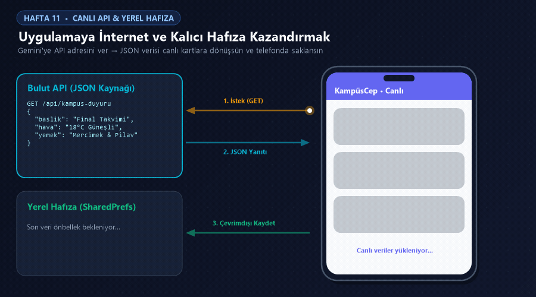
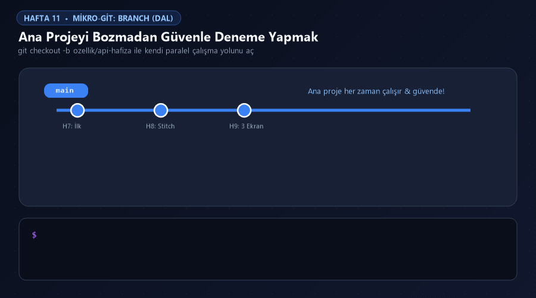

# 🌐 Hafta 11: Uygulamaya Hafıza ve İnternet Kazandıralım — Kalıcı Veri & Canlı API

> Geçen hafta eklediğimiz görevler, uygulama kapanınca **kayboluyordu**. Ayrıca uygulamamız henüz internetten hiçbir bilgi almıyor. Bu hafta önce **geçici/kalıcı hafıza, paket, internet, API, JSON ve Git dalı (branch)** kavramlarını öğreneceğiz. Sonra güvenli bir dalda çalışarak Gemini'ye uygulamamıza **kalıcı hafıza** ve **canlı internet verisi** ekleteceğiz.



---

## 🗺️ Bu Hafta Ne Yapacağız?

| Bölüm | Ne Yapacağız? | Süre |
|---|---|---|
| **Bölüm 1** | Kavramlar: geçici/kalıcı hafıza, paket, `pubspec.yaml`, internet isteği, API, JSON, yükleniyor/hata durumu, servis, branch | 35 dk |
| **Bölüm 2** | Adım adım: Dal aç → Kalıcı hafıza ekle → API'yi tarayıcıda incele → Stitch'te canlı kart tasarla → API bağla → Test | 65 dk |
| **Bölüm 3** | Dalında kaydet | 10 dk |

> 🎯 **Hafta sonunda elinde olacaklar:** Kapatıp açınca verilerini **unutmayan** ve internetten **canlı bilgi** gösteren bir uygulama.

---

## 📖 BÖLÜM 1 — Önce Kavramları Öğrenelim

### 1.1 Geçici Hafıza ve Kalıcı Hafıza
- **Geçici Hafıza:** Uygulama açıkken bilgileri tutar; uygulama kapanınca **silinir**. Hafta 10'daki görevlerimiz buradaydı.
- **Kalıcı Hafıza:** Bilgileri telefonun depolama alanına **yazar**; uygulama kapansa, telefon kapansa bile **silinmez**.
- **Benzetme:** Geçici hafıza bir **beyaz tahta**dır (silinir). Kalıcı hafıza bir **defter**dir (yazdığın kalır).
- **Bizim Projede:** **`shared_preferences`** adlı hazır bir parça kullanarak görevleri "deftere" yazacağız.

### 1.2 Paket ve `pubspec.yaml`
- **Paket:** Başkalarının yazdığı, projemize ekleyip kullanabildiğimiz **hazır kod parçalarıdır**. Flutter paketleri [pub.dev](https://pub.dev) sitesinde bulunur.
- **`pubspec.yaml`:** Projenin **alışveriş listesi**dir; hangi paketleri kullandığımız burada yazar.
- **Benzetme:** Yemek yaparken hamuru sıfırdan yoğurmak yerine **hazır yufka** almak gibi.
- **Bu hafta kullanacağımız 2 paket:**

| Paket | Ne İşe Yarar? |
|---|---|
| `shared_preferences` | Bilgileri telefona kalıcı olarak kaydeder |
| `http` | İnternetten bilgi ister |

> 💡 Paket eklemek için terminal komutu: `flutter pub add paket_adi`. Bunu genelde Gemini bizim için yapacak; biz sadece onaylayacağız.

### 1.3 İnternet İsteği, API ve Adres (URL)
- **İnternet İsteği:** Uygulamanın internetteki bir bilgisayara (**sunucuya**) "Bana şu bilgiyi gönder" demesidir.
- **API:** Sunucunun, uygulamalara bilgi vermek için açtığı **resmi kapıdır**. Her API'nin bir **adresi (URL)** vardır.
- **Benzetme — Restoran:**

| Restoran | Yazılım |
|---|---|
| Sen (müşteri) | Mobil uygulama |
| Garson | **API** |
| Mutfak | Sunucu |
| Sipariş | İstek |
| Tepsideki yemek | **JSON** (gelen bilgi) |

### 1.4 JSON Nedir?
- **Basit Tanım:** API'den gelen bilginin **düzenli yazılış biçimidir**. `"anahtar": değer` şeklinde yazılır.
- **Benzetme:** Bir kimlik kartı: "Ad: Ali, Yaş: 20".
- **Örnek:**
```json
{
  "current_weather": {
    "temperature": 18.4,
    "windspeed": 12.0
  }
}
```
> 💡 Bu yapıyı tanıyorsun! Hafta 6'da öğrendiğimiz **Map** (anahtar → değer) yapısının aynısı.

### 1.5 Yükleniyor, Başarılı ve Hata Durumları
İnternetten bilgi istemek **zaman alır** ve bazen **başarısız olur**. Bu yüzden ekranın 3 hâli olmalıdır:

| Durum | Ne Zaman? | Ekranda Ne Görünür? |
|---|---|---|
| ⏳ **Yükleniyor** | Bilgi yolda | Dönen çember veya gri yanıp sönen kutular |
| ✅ **Başarılı** | Bilgi geldi | Canlı bilgi kartı |
| ❌ **Hata** | İnternet yok / sunucu cevap vermedi | *"Bağlantı yok"* uyarısı + **Tekrar Dene** düğmesi |

> **Zaman aşımı (timeout):** "5 saniye içinde cevap gelmezse beklemeyi bırak ve hata göster" kuralı. Uygulamanın sonsuza kadar donmasını engeller.

### 1.6 Servis Dosyası (`lib/services/`)
- **Basit Tanım:** Hafızaya kaydetme ve internetten veri alma işlerini yapan kodları **ekran dosyalarından ayrı** tuttuğumuz klasördür.
- **Benzetme:** Restoranda garson (ekran) sadece servis yapar; yemeği **mutfak** (servis dosyası) hazırlar.

### 1.7 Git Dalı (Branch)
- **Basit Tanım:** Projenin **paralel bir kopyası** üzerinde çalışmaktır. Dalda yaptığın değişiklikler, sen birleştirene kadar ana projeyi (`main`) **etkilemez**.
- **Benzetme:** Ödevinin **fotokopisi** üzerinde deneme yapmak. Beğenirsen asıl kâğıda geçirirsin, beğenmezsen fotokopiyi atarsın.
- **Neden şimdi?** Paket ekleme ve internet bağlantısı **büyük değişikliklerdir**. Bir şey bozulursa çalışan ana projemiz güvende kalsın.



### 📌 Kavram Özet Tablosu

| Kavram | Tek Cümlelik Hatırlatma |
|---|---|
| Geçici / Kalıcı Hafıza | Beyaz tahta / defter |
| Paket | Projeye eklenen hazır kod parçası |
| `pubspec.yaml` | Projenin paket alışveriş listesi |
| API | Sunucunun bilgi veren kapısı (garson) |
| JSON | Gelen bilginin "anahtar: değer" biçimi |
| Yükleniyor / Hata | İnternet beklerken ve başarısız olunca gösterilen ekranlar |
| `lib/services/` | Hafıza ve internet işlerinin mutfağı |
| Branch (Dal) | Ana projeyi bozmadan çalışılan paralel kopya |

---

## 🛠️ BÖLÜM 2 — Adım Adım: Hafıza ve İnternet Ekleyelim

### ▶️ Adım 1: Güvenli Dalını Aç
**Ne yapıyoruz?** Ödevin fotokopisini alıyoruz.

VS Code terminalinde:
```bash
git checkout -b ozellik/api-hafiza
```
- `checkout -b` = "yeni bir dal oluştur ve ona geç".
- `ozellik/api-hafiza` = dalımızın adı.

✔️ **Kontrol:** VS Code'un **sol alt köşesinde** artık `main` yerine `ozellik/api-hafiza` yazıyor mu?

### ▶️ Adım 2: Kalıcı Hafıza Ekle
**Ne yapıyoruz?** Görevleri beyaz tahtadan deftere taşıyoruz. (`GEMINI.md` kurallarımız olduğu için prompt kısa!)

Agent Mode'a gönder:
```text
Görevler ekranındaki listeyi kalıcı hafızaya kaydetmek istiyorum.
1. shared_preferences paketini projeye ekle.
2. Görev eklendiğinde, işaretlendiğinde ve silindiğinde liste telefona kaydedilsin.
3. Uygulama açıldığında kayıtlı görevler otomatik geri yüklensin.
4. Kayıt kodlarını lib/services/yerel_depolama.dart dosyasına ayır.
Önce kısa bir plan göster, onayımdan sonra uygula.
```
Planı kontrol et → onayla → değişiklikleri **Accept** et. Paket ekleme komutu için onay isterse onu da onayla.

✔️ **Kontrol (En Önemli Test!):**
1. Uygulamayı çalıştır, 2 görev ekle, birini işaretle.
2. Uygulamayı **tamamen kapat** (terminalde `q` veya VS Code'da kırmızı ⏹ Stop düğmesi).
3. Tekrar `F5` ile aç. Görevlerin ve işaretin **duruyor mu?** ✅

### ▶️ Adım 3: API'yi Önce Tarayıcıda İncele
**Ne yapıyoruz?** Garsonun getireceği tepsiye önceden bakıyoruz.

1. [PROJE-PLANI.md](../Hafta-07/PROJE-PLANI.md) kataloğunda projen için önerilen API'yi bul.
2. Örnek (KampüsCep — Open-Meteo hava durumu) adresini tarayıcının adres çubuğuna yapıştır:
```text
https://api.open-meteo.com/v1/forecast?latitude=41.01&longitude=28.97&current_weather=true
```
3. Ekranda JSON göreceksin. `temperature` (sıcaklık) ve `windspeed` (rüzgâr hızı) anahtarlarını bul.

> 💡 Adresteki `latitude` (enlem) ve `longitude` (boylam) değerlerini kendi şehrinin koordinatlarıyla değiştirebilirsin.

✔️ **Kontrol:** Tarayıcıda gelen JSON içinde sıcaklık değerini bulabildin mi?

### ▶️ Adım 4: Google Stitch'te Canlı Bilgi Kartını Tasarla
**Ne yapıyoruz?** Kartın 3 hâlinin (yükleniyor, başarılı, hata) çizimini istiyoruz.

```text
Design a live info card for the top of the home screen of the same app (same colors, Turkish UI), in 3 states:
1. Loading state: grey shimmering placeholder blocks.
2. Success state: weather card showing "18°C • Güneşli" and "Rüzgâr: 12 km/s".
3. Error state: friendly message "Bağlantı yok" with a "Tekrar Dene" button.
```
Görseli `tasarimlar/canli_kart_stitch.png` olarak kaydet.

### ▶️ Adım 5: Canlı API'yi Bağlat
```text
@tasarimlar/canli_kart_stitch.png tasarımına uygun olarak ana sayfanın üstüne canlı hava durumu kartı ekle.
1. http paketini projeye ekle.
2. Veriyi şu adresten al: https://api.open-meteo.com/v1/forecast?latitude=41.01&longitude=28.97&current_weather=true
3. JSON içindeki temperature ve windspeed değerlerini Türkçe etiketlerle göster.
4. Veri gelirken yükleniyor görünümü göster.
5. İnternet yoksa veya 5 saniyede cevap gelmezse uygulama çökmesin; "Bağlantı yok" uyarısı ve "Tekrar Dene" düğmesi göster.
6. İnternet kodunu lib/services/api_servisi.dart dosyasına ayır.
Önce plan göster, onayımdan sonra uygula. Bitince JSON'dan hangi alanı nereye yazdığını 2 maddeyle açıkla.
```

### ▶️ Adım 6: 3 Durumu da Test Et

| Test | Nasıl Yapılır? | Sonuç |
|---|---|---|
| ⏳ Yükleniyor | Uygulamayı aç, ilk saniyelere dikkat et | ☐ |
| ✅ Başarılı | İnternet açıkken gerçek sıcaklık görünüyor | ☐ |
| ❌ Hata | Wi-Fi'yi kapat → **Tekrar Dene**'ye bas → Uygulama çökmeden uyarı veriyor | ☐ |

> 📱 **Android'de internet çalışmazsa:** Gemini'ye *"Android'de internet izni (INTERNET permission) eksik olabilir, AndroidManifest.xml dosyasına ekle"* yaz.

---

## 🌱 BÖLÜM 3 — Mikro-Git: Dalında Kaydet

```bash
git add .
git commit -m "Hafta 11: Kalici hafiza ve canli hava durumu API eklendi"
```

**Dalların gücünü gör:**
```bash
git switch main
```
Uygulamayı çalıştır → Hafıza ve hava kartı **yok**! (Ana proje hâlâ eski, güvenli hâlinde.)
```bash
git switch ozellik/api-hafiza
```
Tekrar çalıştır → Yeni özellikler **geri geldi**!

| Komut | Anlamı |
|---|---|
| `git switch main` | Ana dala (asıl kâğıda) geç |
| `git switch ozellik/api-hafiza` | Deneme dalına (fotokopiye) geç |

> 🔜 Bu dalı ana projeyle **Hafta 12**'de, testlerden geçtikten sonra birleştireceğiz.

✔️ **Kontrol:** Hafta sonunda **`ozellik/api-hafiza`** dalında olduğundan emin ol (sol alt köşe).

---

## ⚠️ Sık Karşılaşılan Sorunlar

| Sorun | Neden? | Ne Yapmalı? |
|---|---|---|
| Paket ekledikten sonra kırmızı hatalar | Paketler indirilmedi | Terminalde `flutter pub get` yaz, uygulamayı durdurup yeniden başlat |
| Görevler hâlâ kayboluyor | Kaydetme/yükleme eksik | *"Uygulama açılınca görevler geri yüklenmiyor, düzelt"* yaz |
| Hava kartı hep "yükleniyor"da kalıyor | Zaman aşımı yok veya adres hatalı | Adresi tarayıcıda dene; *"5 saniyelik zaman aşımı ekle"* yaz |
| `git switch` "değişiklikleriniz kaybolacak" uyarısı verdi | Kaydedilmemiş değişiklik var | Önce `git add .` ve `git commit` yap |

---

## 📝 Haftalık Ödev

1. `ozellik/api-hafiza` dalını aç.
2. Kalıcı hafızayı ekle ve **kapat-aç testini** geç.
3. Projene uygun API'yi tarayıcıda incele, Stitch'te 3 durumlu kartı tasarla ve bağlat.
4. 3 durumu (yükleniyor, başarılı, hata) test et.
5. Dalında `commit` al.

### ✅ Hafta 11 Kontrol Listesi
- [ ] Geçici ve kalıcı hafıza farkını anlatabiliyorum.
- [ ] API ve JSON'u restoran örneğiyle açıklayabiliyorum.
- [ ] Uygulamam kapatılıp açılınca verilerini unutmuyor.
- [ ] Canlı API verisi geliyor; internet yokken uygulama çökmüyor.
- [ ] Ayrı bir dalda çalıştım ve `git switch` ile dallar arasında geçiş yaptım.

---

### 🔗 Ders Navigasyonu
⬅️ [Hafta 10: Etkileşim ve State](../Hafta-10/README.md) | 🏠 [Ana Sayfa](../README.md) | ➡️ [Hafta 12: Hata Ayıklama, Test & Birleştirme](../Hafta-12/README.md)
