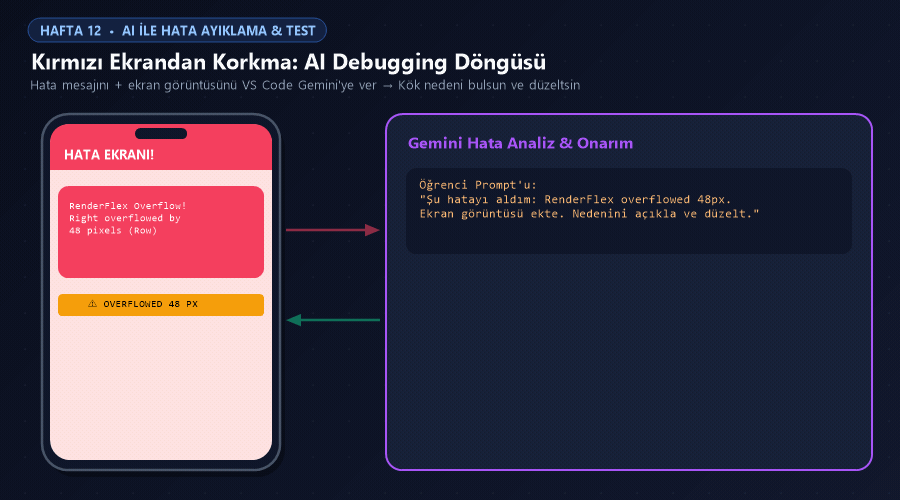
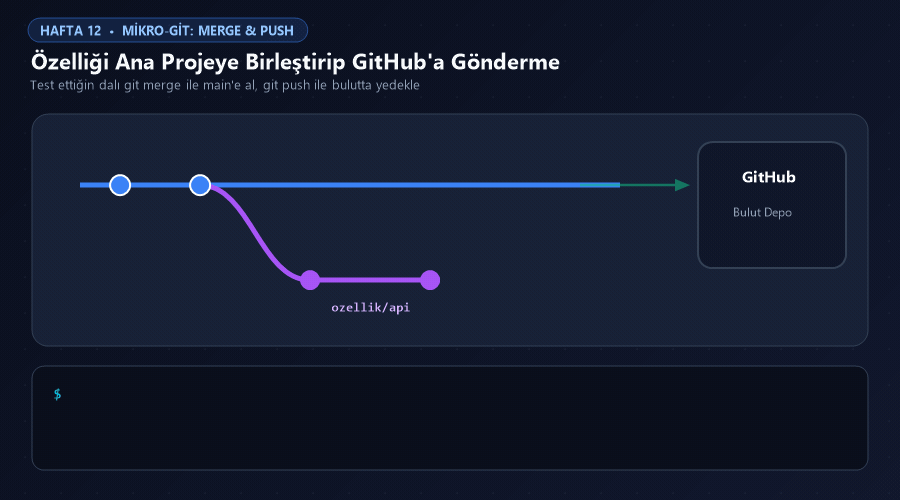

# 🩺 Hafta 12: Hataları AI ile Bulup Düzeltmek, Uygulamayı Test Etmek ve Dalı Birleştirmek

> Uygulamamız artık hafızalı ve internetli. Ama bu özellikleri hâlâ **deneme dalında** tutuyoruz. Ana projeye almadan önce gerçek yazılımcılar gibi **hataları ayıklayacak, kalite kontrolü yapacak ve otomatik test** çalıştıracağız. Bu hafta önce **hata türleri, hata mesajı okuma, taşma, kalite kontrol ve test** kavramlarını öğreneceğiz; sonra Gemini ile adım adım hata ayıklayıp dalımızı ana projeyle birleştireceğiz.



---

## 🗺️ Bu Hafta Ne Yapacağız?

| Bölüm | Ne Yapacağız? | Süre |
|---|---|---|
| **Bölüm 1** | Kavramlar: hata (bug), hata türleri, Problems/Debug Console, taşma, hata ayıklama, kalite kontrol, otomatik test, merge | 30 dk |
| **Bölüm 2** | Adım adım: Hata paketini hazırla → Gemini ile çöz → Kalite denetimi → Küçük ekranda tasarım kontrolü → Test yazdır ve çalıştır | 65 dk |
| **Bölüm 3** | Dalı ana projeye birleştir (`merge`) ve GitHub'a gönder | 15 dk |

> 🎯 **Hafta sonunda elinde olacaklar:** Hatasız, küçük ekranlara uyumlu, **otomatik testleri yeşil geçen** ve GitHub'daki ana dalda yayında olan bir uygulama.

---

## 📖 BÖLÜM 1 — Önce Kavramları Öğrenelim

### 1.1 Hata (Bug) Nedir?
- **Basit Tanım:** Uygulamanın beklenmedik veya yanlış davranmasıdır.
- **Benzetme:** Yemek tarifinde bir adımın unutulması — yemek yine pişer ama tadı tuhaf olur.
- **Önemli:** Hata almak **başarısızlık değildir**. Profesyonel yazılımcılar da her gün hata alır. Fark, hatayı **nasıl çözdüğündedir**.

### 1.2 Üç Hata Türü

| Tür | Ne Zaman Görülür? | Nasıl Anlarız? | Örnek |
|---|---|---|---|
| **Yazım/Derleme Hatası** | Uygulama **hiç açılmaz** | Kodda kırmızı dalgalı çizgi, Problems panelinde kırmızı ❌ | Eksik parantez |
| **Çalışma Hatası** | Uygulama açılır ama bir işlemde **çöker** veya kırmızı ekran çıkar | Debug Console'da kırmızı yazılar | Boş veriye erişmek |
| **Mantık Hatası** | Uygulama çalışır ama **yanlış sonuç** verir | Ancak **test ederek** fark edilir | Sayaç 1 yerine 2 artıyor |

### 1.3 VS Code'da Hataları Nerede Görürüz?

| Panel | Nasıl Açılır? | Ne Gösterir? |
|---|---|---|
| **Problems (Sorunlar)** | `Ctrl + Shift + M` | Koddaki tüm hata ❌ ve uyarıları ⚠️ listeler |
| **Debug Console** | Uygulama `F5` ile çalışırken alt panel | Uygulama çalışırken oluşan hata mesajları |
| **Terminal** | `` Ctrl + ` `` | Komut çıktıları ve test sonuçları |

### 1.4 Hata Mesajı Nasıl Okunur?
Hata mesajları İngilizce ve uzundur ama **ilk satır** genelde en önemlisidir.
```text
A RenderFlex overflowed by 48 pixels on the right.
```
| Parça | Anlamı |
|---|---|
| `RenderFlex` | Yan yana / alt alta dizilen bir düzen (satır/sütun) |
| `overflowed` | taştı |
| `by 48 pixels` | 48 piksel kadar |
| `on the right` | sağ taraftan |

> 💡 **İpucu:** Hata mesajını anlamazsan Gemini'ye *"Bu hata mesajını bana basit Türkçeyle açıkla"* diyebilirsin.

### 1.5 Taşma (Overflow) ve Ekran Boyutları
- **Basit Tanım:** İçeriğin ekrana sığmayıp dışarı taşmasıdır. Flutter bunu **sarı-siyah çizgili bir şeritle** gösterir.
- **Benzetme:** Bavula sığmayan kıyafetin fermuarın arasından taşması.
- **Neden olur?** Herkesin telefonu farklı boyuttadır. Senin geniş ekranında sığan yazı, küçük bir telefonda (**360 piksel genişlik**) sığmayabilir.

### 1.6 Hata Ayıklama (Debugging) ve 3'lü Hata Paketi
- **Basit Tanım:** Hatanın **nedenini bulup** düzeltme sürecidir.
- **Benzetme:** Doktora gittiğinde sadece "hastayım" demezsin; **ne zaman başladığını, ne hissettiğini** anlatırsın. Gemini de bir doktor gibidir; ne kadar bilgi verirsen o kadar doğru teşhis koyar.
- **3'lü Hata Paketi:**
  1. **Ne yapıyordum?** (Hata hangi işlemde çıktı?)
  2. **Hata mesajı** (Kopyala-yapıştır)
  3. **Ekran görüntüsü** (Ne gördüğün)

### 1.7 Kalite Kontrol ve Otomatik Test
- **Kalite Kontrol:** Henüz hata görmeden, olası sorunları önceden aramaktır.
- **Otomatik Test:** Uygulamanın doğru çalışıp çalışmadığını **bilgisayarın kendisinin kontrol ettiği** küçük programlardır. Testler `test/` klasöründe durur ve **`flutter test`** komutuyla çalışır.
- **Benzetme:** Fabrikada her araba çıkmadan önce **otomatik kontrol bandından** geçer: "Farlar yanıyor mu? ✅ Frenler çalışıyor mu? ✅"
- **Neden önemli?** İleride yeni bir özellik eklediğinde, eski özelliklerin bozulup bozulmadığını saniyeler içinde anlarsın.

| Test Sonucu | Anlamı |
|---|---|
| ✅ `All tests passed!` | Tüm testler geçti |
| ❌ `Some tests failed` | En az bir test başarısız; bir şey bozuk |

### 1.8 Birleştirme (Merge)
- **Basit Tanım:** Deneme dalında yaptığın değişiklikleri **ana dala (`main`) aktarmaktır**.
- **Benzetme:** Fotokopide denediğin ve beğendiğin çözümü **asıl ödev kâğıdına geçirmek**.

### 📌 Kavram Özet Tablosu

| Kavram | Tek Cümlelik Hatırlatma |
|---|---|
| Bug | Uygulamanın yanlış davranması |
| 3 hata türü | Yazım (açılmaz) / Çalışma (çöker) / Mantık (yanlış sonuç) |
| Problems paneli | `Ctrl+Shift+M` — tüm hataların listesi |
| Overflow | İçeriğin ekrana sığmaması (sarı-siyah şerit) |
| 3'lü Hata Paketi | Ne yapıyordum + hata mesajı + ekran görüntüsü |
| Otomatik test | Bilgisayarın uygulamayı kendi kontrol etmesi |
| Merge | Dalı ana projeye birleştirmek |

---

## 🛠️ BÖLÜM 2 — Adım Adım: AI ile Hata Ayıklama ve Test

> Başlamadan önce sol alt köşede **`ozellik/api-hafiza`** dalında olduğundan emin ol. Değilse: `git switch ozellik/api-hafiza`

### ▶️ Adım 1: Mevcut Hataları Topla
**Ne yapıyoruz?** Hastalığın belirtilerini listeliyoruz.

1. `Ctrl + Shift + M` ile **Problems** panelini aç. Kırmızı ❌ ve sarı ⚠️ sayılarını not al.
2. Uygulamayı `F5` ile çalıştır ve her ekranı, her düğmeyi dene.
3. Bulduğun sorunları bir listeye yaz.

✔️ **Kontrol:** Bulduğun sorunların listesi hazır mı? (Hiç yoksa Adım 2'deki örnek hatayı bilerek oluştur.)

### ▶️ Adım 2: Bilerek Bir Hata Oluştur ve 3'lü Paketle Çöz
**Ne yapıyoruz?** Hata ayıklamayı güvenli bir örnekle pratik ediyoruz.

1. Uygulamada **çok uzun bir görev adı** ekle: *"Mobil programlama dersi için Stitch tasarımlarını tamamlayıp GitHub'a yüklemeyi unutma"*.
2. Sarı-siyah taşma şeridi çıktıysa ekran görüntüsü al (`Windows + Shift + S`) ve `tasarimlar/hata_ornegi.png` olarak kaydet.
3. Debug Console'daki hata mesajını kopyala.
4. Gemini'ye **3'lü Hata Paketi** ile gönder:

```text
HATA AYIKLAMA TALEBİ
1. NE YAPIYORDUM?: Görevler ekranına çok uzun bir görev adı ekledim.
2. HATA MESAJI: A RenderFlex overflowed by 48 pixels on the right.
3. EKRAN GÖRÜNTÜSÜ: @tasarimlar/hata_ornegi.png

İSTEĞİM:
- Önce hatanın nedenini 2 sade Türkçe cümleyle açıkla.
- Sonra sadece ilgili dosyayı düzelt, başka yerlere dokunma.
- Uzun yazılar sığmazsa sonuna "..." koyarak kısalt.
```

✔️ **Kontrol:** Aynı uzun görevi tekrar ekle. Taşma şeridi kayboldu mu ve yazı `...` ile kısaldı mı?

### ▶️ Adım 3: AI Kalite Denetimi Yaptır
**Ne yapıyoruz?** Gemini'ye fabrika kontrolcüsü gibi tüm projeyi taratıyoruz.

```text
Bir "Mobil Kalite Kontrol Uzmanı" gibi davran ve lib/ klasörümün tamamını incele:
1. Küçük telefonlarda (360 piksel genişlik) taşma riski olan yerleri bul.
2. İnternet yokken veya boş veri geldiğinde çökebilecek yerleri bul.
3. Unutulmuş İngilizce yazıları bul.
4. Problems panelindeki uyarıları listele.
ŞİMDİLİK DÜZELTME YAPMA. Bulduklarını "Sorun – Dosya – Önerilen Çözüm" sütunlu bir tabloyla göster.
```
Tabloyu incele, sonra:
```text
Tablodaki tüm sorunları düzelt. Bitince Problems panelinde kalan sorun sayısını söyle.
```

✔️ **Kontrol:** Problems panelinde kırmızı ❌ hata kalmadı mı?

### ▶️ Adım 4: Google Stitch ile Küçük Ekran Kontrolü
**Ne yapıyoruz?** Tasarımımızın küçük telefonda nasıl görünmesi gerektiğini mimara soruyoruz.

1. Stitch'te ana ekran tasarımını aç ve yaz:
```text
Show how this exact screen should look on a small phone (360px wide). Keep all elements readable; long texts should be shortened with "...".
```
2. Görseli `tasarimlar/kucuk_ekran_stitch.png` olarak kaydet.
3. Chrome'da çalışan uygulamada `F12` → üstteki **telefon simgesi** (Toggle device toolbar) → genişliği **360** yap ve Stitch görseliyle karşılaştır.
4. Fark varsa Gemini'ye `@tasarimlar/kucuk_ekran_stitch.png` görseliyle birlikte anlat.

✔️ **Kontrol:** 360 piksel genişlikte hiçbir ekranda sarı-siyah şerit yok mu?

### ▶️ Adım 5: Otomatik Testleri Yazdır
**Ne yapıyoruz?** Fabrikaya otomatik kontrol bandı kuruyoruz.

```text
Uygulamamın temel özelliklerinin bozulmadığını kontrol eden 3 basit widget testi yaz ve test/app_test.dart dosyasına koy:
1. Uygulama açılıyor ve ana sayfa başlığı görünüyor.
2. Alt menüdeki "Profil" sekmesine dokununca profil ekranı açılıyor.
3. Ekleme penceresinde kutu boşken Kaydet'e basınca uyarı mesajı görünüyor.
Her testin üstüne ne kontrol ettiğini anlatan 1 Türkçe yorum satırı yaz.
Testlerde internete bağlanma; gerekiyorsa sahte (örnek) veri kullan.
```

### ▶️ Adım 6: Testleri Çalıştır
VS Code terminalinde:
```bash
flutter test
```
Beklenen sonuç:
```text
00:05 +3: All tests passed!
```
- `+3` = 3 test geçti.
- Kırmızı `FAILED` görürsen çıktıyı kopyala ve Gemini'ye: *"Bu test başarısız oldu, nedenini açıkla ve düzelt"* yaz.

✔️ **Kontrol:** `All tests passed!` yazısını gördün mü? 🎉

---

## 🌱 BÖLÜM 3 — Mikro-Git: Dalı Ana Projeye Birleştir



Testler geçti; artık fotokopideki çözümü asıl kâğıda geçirebiliriz.

**1. Dalındaki son değişiklikleri kaydet:**
```bash
git add .
git commit -m "Hafta 12: Hata duzeltmeleri, kalite kontrol ve testler eklendi"
```

**2. Ana dala geç:**
```bash
git switch main
```

**3. Deneme dalını ana dala birleştir:**
```bash
git merge ozellik/api-hafiza
```

**4. GitHub'a gönder:**
```bash
git push
```

| Komut | Anlamı |
|---|---|
| `git switch main` | Asıl kâğıda dön |
| `git merge ozellik/api-hafiza` | Fotokopideki çözümleri asıl kâğıda geçir |
| `git push` | Güncel hâli GitHub'a yedekle |

✔️ **Kontrol:**
- Sol alt köşede **`main`** yazıyor mu?
- Uygulamayı çalıştır: Hafıza, hava kartı ve hata düzeltmeleri **ana dalda** da var mı?
- GitHub sayfanda `lib/services/` ve `test/` klasörlerini görüyor musun?

---

## ⚠️ Sık Karşılaşılan Sorunlar

| Sorun | Neden? | Ne Yapmalı? |
|---|---|---|
| Gemini başka dosyaları da değiştirdi | "Sadece ilgili dosya" denmedi | **Reject** et, prompt'a *"başka dosyaya dokunma"* ekle |
| `flutter test` internet hatası verdi | Test gerçek API'ye bağlanmaya çalıştı | *"Testlerde sahte veri kullan, internete bağlanma"* yaz |
| `merge` sırasında "CONFLICT" yazdı | Aynı satır iki dalda farklı değişmiş | Panik yapma! Eğitmenine haber ver veya Gemini'ye *"Git conflict oluştu, çözmeme yardım et"* yaz |
| `git merge` sonrası bir editör penceresi açıldı | Git birleştirme mesajı istiyor | Terminalde açıldıysa `:wq` yazıp `Enter`'a bas; VS Code'da açıldıysa dosyayı kaydedip kapat |

---

## 📝 Haftalık Ödev

1. 3'lü Hata Paketi ile en az 1 hatayı Gemini'ye çözdür ve nedenini not al.
2. Kalite denetimini çalıştır; Problems panelini sıfırla.
3. Stitch küçük ekran görseliyle 360 piksel testini yap.
4. 3 otomatik test yazdır ve `flutter test` ile yeşil geçir.
5. Dalı `main`'e birleştir ve `git push` yap.

### ✅ Hafta 12 Kontrol Listesi
- [ ] 3 hata türünü ve VS Code'da nerede göründüklerini biliyorum.
- [ ] Bir hata mesajının ilk satırını okuyup anlamını çıkarabiliyorum.
- [ ] 3'lü Hata Paketi ile Gemini'ye hata çözdürdüm.
- [ ] Problems panelinde kırmızı hata kalmadı; 360 piksel ekranda taşma yok.
- [ ] `flutter test` → `All tests passed!`
- [ ] Dalımı `main`'e birleştirip GitHub'a gönderdim.

---

### 🔗 Ders Navigasyonu
⬅️ [Hafta 11: Kalıcı Hafıza & Canlı API](../Hafta-11/README.md) | 🏠 [Ana Sayfa](../README.md) | ➡️ [Hafta 13: Görsel Cila, Koyu Mod, İkon & Açılış Ekranı](../Hafta-13/README.md)
