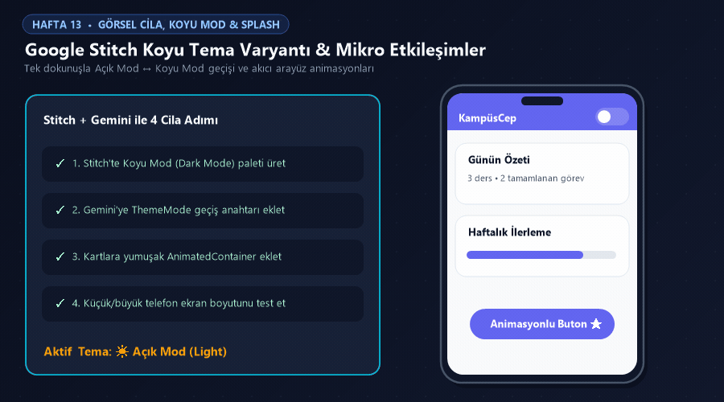
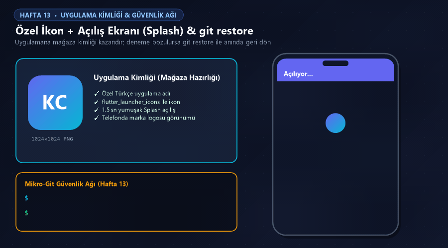

# ✨ Hafta 13: Uygulamayı Parlatalım — Koyu Mod, Animasyon, Uygulama İkonu ve Açılış Ekranı

> Uygulamamız çalışıyor, hatasız ve testli. Şimdi onu **mağazadaki uygulamalar kadar şık** hâle getirme zamanı! Bu hafta önce **tema, koyu mod, kontrast, animasyon, uygulama ikonu ve açılış ekranı** kavramlarını öğreneceğiz. Sonra Google Stitch ile koyu tema ve ikon tasarlayıp Gemini'ye adım adım uygulatacağız. Bu sırada bir şeyi bozarsak **Git ile nasıl geri döneceğimizi** de öğreneceğiz.



---

## 🗺️ Bu Hafta Ne Yapacağız?

| Bölüm | Ne Yapacağız? | Süre |
|---|---|---|
| **Bölüm 1** | Kavramlar: tema, açık/koyu mod, kontrast, animasyon, uygulama ikonu, açılış ekranı, `assets`, geri alma | 30 dk |
| **Bölüm 2** | Adım adım: Stitch koyu mod → Tema anahtarı → Animasyon → Stitch'te ikon → İkon + açılış ekranı | 70 dk |
| **Bölüm 3** | `git restore` ile geri alma pratiği, `git pull`, kaydet ve gönder | 10 dk |

> 🎯 **Hafta sonunda elinde olacaklar:** Açık/koyu tema seçebilen, yumuşak animasyonlu, **kendi logosuyla açılan** profesyonel görünümlü bir uygulama.

---

## 📖 BÖLÜM 1 — Önce Kavramları Öğrenelim

### 1.1 Tema Nedir?
- **Basit Tanım:** Uygulamanın **tüm ekranlarında ortak kullanılan** renk, yazı tipi ve şekil ayarlarının toplamıdır.
- **Benzetme:** Bir evin **dekorasyon konsepti**. Duvar rengini konseptten değiştirirsen bütün odalar birden değişir; odaları tek tek boyamana gerek kalmaz.
- **Bizim Projede:** Renkler `main.dart` içindeki tema ayarından gelir. Bu yüzden koyu modu tek bir yerden açıp kapatabileceğiz.

### 1.2 Açık Mod ve Koyu Mod (Dark Mode)
- **Açık Mod:** Açık arka plan + koyu yazı.
- **Koyu Mod:** Koyu arka plan + açık yazı.
- **Neden koyu mod?** Gece kullanımında gözü daha az yorar ve birçok kullanıcı tarafından tercih edilir.
- **Benzetme:** Odanın **gündüz** ve **gece** aydınlatması.

### 1.3 Kontrast ve Okunabilirlik
- **Basit Tanım:** Yazı rengiyle arka plan rengi arasındaki **farkın büyüklüğüdür**. Fark azsa yazı okunmaz.
- **Benzetme:** Siyah tahtaya **beyaz** tebeşirle yazmak kolay okunur; **koyu gri** tebeşirle yazmak okunmaz.
- **Kural:** Koyu modda yazılar açık renk, açık modda koyu renk olmalı. Renkleri tek tek seçmek zor olduğu için **Stitch'ten hazır koyu palet** alacağız.

### 1.4 Animasyon ve Mikro Etkileşim
- **Animasyon:** Ekrandaki bir değişikliğin **aniden değil, yumuşakça** olmasıdır.
- **Mikro Etkileşim:** Küçük ama hoş geri bildirimlerdir (düğmeye basınca hafif küçülmesi, görev tamamlanınca rengin yavaşça yeşile dönmesi).
- **Benzetme:** Kapının **çarparak** değil, **yavaşça** kapanması.
- **Altın Kural:** Az ve kısa animasyon (0.3 saniye civarı) **şık** durur; çok fazla animasyon **yorar**.

### 1.5 Uygulama İkonu
- **Basit Tanım:** Telefon ana ekranında uygulamayı temsil eden küçük resimdir.
- **Benzetme:** Bir mağazanın **tabelası/logosu**.
- **Teknik Bilgi:** Ana ikon **1024×1024 piksel** ve **PNG** formatında hazırlanır. `flutter_launcher_icons` paketi bu tek resimden telefonların ihtiyaç duyduğu tüm boyutları otomatik üretir.

### 1.6 Açılış Ekranı (Splash Screen)
- **Basit Tanım:** Uygulama açılırken 1-2 saniye görünen, logo ve isim içeren ekrandır.
- **Benzetme:** Bir filmin başındaki **yapımcı logosu**.

### 1.7 `assets` Klasörü
- **Basit Tanım:** Uygulamada kullanılan resim, ikon gibi dosyaların konduğu klasördür.
- **Bizim Projede:** İkonumuz `assets/icon/app_icon.png` yolunda duracak.

> ⚠️ `assets` klasörüne konan dosyaların uygulamada kullanılabilmesi için `pubspec.yaml` dosyasında tanıtılması gerekir. Bunu Gemini yapacak, biz kontrol edeceğiz.

### 1.8 Geri Alma: `git restore` ve Eşitleme: `git pull`
- **`git restore dosya`:** Bir dosyayı **son kayıt (commit) hâline** geri döndürür. Kaydedilmemiş değişiklikler silinir.
- **`git pull`:** GitHub'daki en güncel hâli bilgisayarına **çeker**.
- **Benzetme:** `restore` = oyunda **son kayıt noktasından yeniden başlamak**. `pull` = başka bilgisayarda kaldığın yerden devam etmek için buluttaki dosyayı indirmek.
- **Neden bu hafta?** Görsel denemeler sırasında "eski hâli daha güzeldi" demek çok olur!

### 📌 Kavram Özet Tablosu

| Kavram | Tek Cümlelik Hatırlatma |
|---|---|
| Tema | Tüm ekranların ortak renk/yazı ayarı |
| Koyu Mod | Koyu arka plan + açık yazı |
| Kontrast | Yazı ve arka plan arasındaki renk farkı |
| Animasyon | Değişikliğin yumuşak olması |
| Uygulama İkonu | 1024×1024 PNG, ana ekrandaki logo |
| Açılış Ekranı | Uygulama açılırken görünen logo ekranı |
| `assets` | Resim/ikon dosyalarının klasörü |
| `git restore` | Dosyayı son kayıt hâline döndür |
| `git pull` | GitHub'daki güncel hâli indir |

---

## 🛠️ BÖLÜM 2 — Adım Adım: Uygulamayı Parlatalım

> **Güvenlik önlemi:** Başlamadan önce `git status` yaz. *"working tree clean"* görmelisin. Görmüyorsan önce `git add .` ve `git commit` yap. Böylece bu hafta bir şey bozulursa dönebileceğin temiz bir kayıt noktan olur.

### ▶️ Adım 1: Google Stitch'te Koyu Mod Tasarla
**Ne yapıyoruz?** Mimardan evin gece aydınlatma planını istiyoruz.

Stitch'te ana ekranını aç ve yaz:
```text
Create a Dark Mode version of this exact screen.
Use a deep navy background (#0F172A), dark cards (#1E293B), soft borders (#334155), white readable text, and keep the same accent colors. Keep the same layout and Turkish texts.
```
Görseli `tasarimlar/koyu_mod_stitch.png` olarak kaydet.

✔️ **Kontrol:** Koyu tasarımda tüm yazılar rahatça okunuyor mu (kontrast yeterli mi)?

### ▶️ Adım 2: Tema Değiştirme Anahtarı Ekle
**Ne yapıyoruz?** Kullanıcıya gündüz/gece düğmesi veriyoruz.

```text
@tasarimlar/koyu_mod_stitch.png tasarımına uygun bir koyu tema ekle.
1. Profil ekranına "Koyu Mod" adında bir açma/kapama anahtarı koy.
2. Anahtar açılınca tüm uygulama koyu temaya, kapanınca açık temaya geçsin.
3. Kullanıcının seçimi kalıcı hafızaya (shared_preferences) kaydedilsin; uygulama tekrar açılınca aynı temayla başlasın.
4. Koyu temada tüm yazıların okunabilir olduğundan emin ol.
Önce plan göster, onayımdan sonra uygula.
```

✔️ **Kontrol:**
- [ ] Anahtar tüm ekranların rengini değiştiriyor.
- [ ] Uygulamayı kapatıp açınca seçtiğin tema korunuyor.
- [ ] Koyu modda okunamayan yazı yok.

### ▶️ Adım 3: Mikro Animasyonlar Ekle
**Ne yapıyoruz?** Kapıların yavaşça kapanmasını sağlıyoruz.

```text
Uygulamaya az ve zarif animasyonlar ekle:
1. Görev tamamlandığında kartın rengi 0.3 saniyede yumuşakça değişsin.
2. Alt menüde sekme değiştirirken ekranlar yumuşak bir geçişle (solma) değişsin.
3. Yeni görev listeye eklenirken hafifçe belirsin.
Animasyonları abartma; uygulamayı yavaşlatmasın.
```

✔️ **Kontrol:** Görev işaretleyince renk **yavaşça** mı değişiyor? Sekme geçişi akıcı mı?

> 🔄 **Beğenmedin mi?** Bu noktada animasyonlardan memnun değilsen Bölüm 3'teki `git restore` yöntemini kullanabilirsin.

### ▶️ Adım 4: Google Stitch ile Uygulama İkonu Tasarla
**Ne yapıyoruz?** Mağazamızın tabelasını çizdiriyoruz.

1. Stitch'te yaz (kendi uygulama adınla):
```text
Design a simple, modern app icon for an app named "KampüsCep". Square 1024x1024, a bold letter mark "KC" or a simple symbol, using the app's Indigo and Emerald colors, flat design, no small text.
```
2. Beğendiğin ikonu PNG olarak indir.
3. Proje klasöründe **`assets`** → içinde **`icon`** klasörü oluştur ve resmi **`app_icon.png`** adıyla buraya koy.

> 💡 **İyi ikon kuralları:** Sade olsun, küçük yazı içermesin (ana ekranda okunmaz), en fazla 2-3 renk kullansın.

✔️ **Kontrol:** `assets/icon/app_icon.png` dosyası var mı?

### ▶️ Adım 5: İkonu, Uygulama Adını ve Açılış Ekranını Kurdur
**Ne yapıyoruz?** Tabelayı asıp, girişe karşılama ekranı koyuyoruz.



```text
Uygulamaya profesyonel kimlik kazandır:
1. Telefonda görünen uygulama adını "KampüsCep" yap.
2. assets/icon/app_icon.png dosyasını flutter_launcher_icons paketiyle uygulama ikonu olarak ayarla ve gerekli komutu çalıştır.
3. Uygulama açılırken 1.5 saniye logomuzu ve "Akıllı Öğrenci Asistanı" yazısını gösteren sade bir açılış ekranı ekle, sonra ana sayfaya geçsin.
4. Açılış ekranı açık ve koyu temaya uygun görünsün.
Önce plan göster, onayımdan sonra uygula. Bitince pubspec.yaml dosyasında neyi değiştirdiğini açıkla.
```

✔️ **Kontrol:**
- [ ] Uygulama açılırken logolu açılış ekranı görünüyor ve ardından ana sayfa geliyor.
- [ ] `pubspec.yaml` dosyasında `flutter_launcher_icons` ayarı var.
- [ ] *(Emülatör/telefonda)* Ana ekranda kendi ikonun görünüyor. *(Chrome'da ikon görünmez; bunu Hafta 14'te telefonda göreceğiz.)*

---

## 🌱 BÖLÜM 3 — Mikro-Git: Geri Alma ve Eşitleme

### ▶️ Adım 6: `git restore` ile Geri Alma Pratiği
**Ne yapıyoruz?** Bilerek bir dosyayı bozup son kayıt noktasından kurtarıyoruz.

1. Önce şu ana kadarki güzel hâli kaydet:
```bash
git add .
git commit -m "Hafta 13: Koyu mod, animasyon, ikon ve acilis ekrani eklendi"
```
2. `lib/main.dart` dosyasını aç, rastgele birkaç satır sil ve kaydet. (Uygulama bozulacak — merak etme!)
3. `git status` yaz → `main.dart` kırmızı görünür (değişmiş).
4. Kurtar:
```bash
git restore lib/main.dart
```
5. Dosyaya tekrar bak — **silinen satırlar geri geldi!** 🎉

> ⚠️ **Dikkat:** `git restore` kaydedilmemiş değişiklikleri **kalıcı olarak siler**. Sadece gerçekten geri dönmek istediğinde kullan. Tüm dosyaları geri almak için: `git restore .`

### ▶️ Adım 7: Gönder ve `git pull` Öğren
```bash
git push
```
Başka bir bilgisayardan (örn. evden laboratuvara) devam edeceğin zaman, proje klasöründe önce şunu yaz:
```bash
git pull
```
Bu komut GitHub'daki son hâli bilgisayarına indirir.

✔️ **Kontrol:** GitHub'da `assets/icon/app_icon.png` dosyasını görüyor musun?

---

## ⚠️ Sık Karşılaşılan Sorunlar

| Sorun | Neden? | Ne Yapmalı? |
|---|---|---|
| Koyu modda bazı yazılar görünmüyor | O yazıların rengi sabit yazılmış | *"Koyu modda şu yazı okunmuyor, rengini temadan alsın"* yaz |
| Tema seçimi kapat-aç sonrası unutuluyor | Kalıcı kayıt eksik | *"Tema tercihi kalıcı hafızaya kaydedilmiyor, düzelt"* yaz |
| İkon değişmedi | İkon komutu çalışmadı veya Chrome'da bakılıyor | Terminalde `dart run flutter_launcher_icons` yaz; emülatörde uygulamayı silip yeniden kur |
| `Unable to load asset` hatası | `pubspec.yaml` içinde `assets` tanımlı değil | Gemini'ye bu hatayı 3'lü Hata Paketiyle gönder |

---

## 📝 Haftalık Ödev

1. Stitch'te koyu mod tasarla ve tema anahtarını ekle (kalıcı tercihle).
2. En az 2 yerde yumuşak animasyon ekle.
3. Stitch ile 1024×1024 ikon tasarla, ikon ve açılış ekranını kur.
4. `git restore` pratiğini yap, ardından `commit` ve `push` ile gönder.

### ✅ Hafta 13 Kontrol Listesi
- [ ] Tema, kontrast ve animasyon kavramlarını anlatabiliyorum.
- [ ] Koyu mod anahtarım çalışıyor ve seçim hatırlanıyor.
- [ ] Uygulamamda az ve zarif animasyonlar var.
- [ ] Kendi ikonum ve açılış ekranım hazır.
- [ ] `git restore` ile bozduğum bir dosyayı geri getirdim.
- [ ] Güncel hâli GitHub'a gönderdim.

---

### 🔗 Ders Navigasyonu
⬅️ [Hafta 12: Hata Ayıklama, Test & Merge](../Hafta-12/README.md) | 🏠 [Ana Sayfa](../README.md) | ➡️ [Hafta 14: APK, GitHub Vitrini & Final Sunumu](../Hafta-14/README.md)
