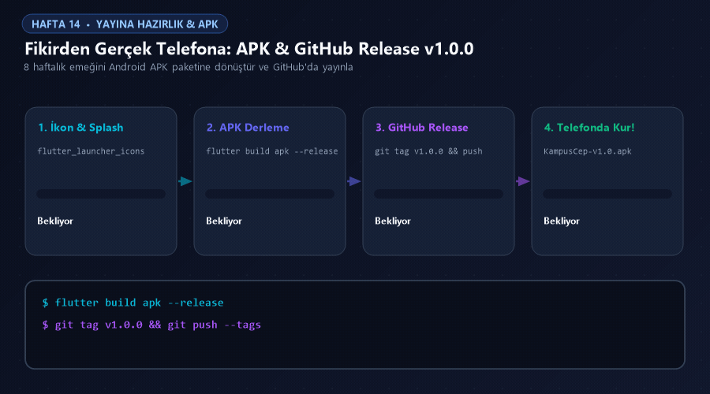
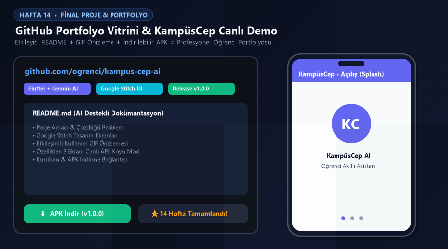

# 🏆 Hafta 14: Final — Telefona Kurulabilen APK, GitHub Vitrini ve Proje Sunumu

> 7. haftada *"Kod bilmeden nasıl uygulama yapacağım?"* diye başladık. Bugün elimizde Google Stitch ile tasarlanmış, VS Code Gemini ile geliştirilmiş, hafızalı, internetli, testli ve koyu modlu bir uygulama var! Bu hafta önce **derleme, APK, sürüm, etiket, Release ve README** kavramlarını öğreneceğiz. Sonra adım adım uygulamamızı **gerçek bir telefona kuracak**, GitHub'da **yayınlayacak** ve **sunumumuzu** hazırlayacağız.



---

## 🗺️ Bu Hafta Ne Yapacağız?

| Bölüm | Ne Yapacağız? | Süre |
|---|---|---|
| **Bölüm 1** | Kavramlar: derleme, debug/release, APK, telefona kurulum, sürüm numarası, etiket, GitHub Release, README, portfolyo | 25 dk |
| **Bölüm 2** | Adım adım: Son kontrol → APK derle → Telefona kur ve test et → Stitch ile sunum görselleri → AI ile README | 60 dk |
| **Bölüm 3** | `v1.0.0` etiketi + GitHub Release ile APK yayını | 15 dk |
| **Bölüm 4** | 5 dakikalık final sunumu | Sunum günü |

> 🎯 **Hafta sonunda elinde olacaklar:** Herkesin indirip telefonuna kurabileceği **`v1.0.0` APK**, profesyonel bir **GitHub vitrini** ve **final sunumun**.

---

## 📖 BÖLÜM 1 — Önce Kavramları Öğrenelim

### 1.1 Derleme (Build)
- **Basit Tanım:** Yazdığımız kod dosyalarını, telefonun anlayıp çalıştırabileceği **tek bir pakete dönüştürme** işlemidir.
- **Benzetme:** Malzemeleri (un, şeker, yumurta) fırınlayıp **pastaya dönüştürmek**. Pastayı herkese verebilirsin; malzemeleri veremezsin.

### 1.2 Debug ve Release Modu

| Mod | Ne Zaman? | Özelliği |
|---|---|---|
| **Debug (Geliştirme)** | Geliştirirken (`F5`) | Hot Reload var, hata ayıklama kolay, ama **yavaş ve büyük** |
| **Release (Yayın)** | Kullanıcılara verirken | **Hızlı, küçük ve optimize**, hata ayıklama araçları yok |

- **Benzetme:** Debug = **prova**, Release = **asıl gösteri**.

### 1.3 APK Nedir?
- **Basit Tanım:** Android telefonlara uygulama kurmak için kullanılan **kurulum dosyasıdır** (`.apk` uzantılı).
- **Benzetme:** Bilgisayardaki `.exe` kurulum dosyasının Android'deki karşılığı.
- **Bizim Projede:** `flutter build apk --release` komutuyla oluşturacağız.

> 📱 **Bilinmeyen kaynaklar:** Play Store dışından APK kurarken telefon *"Bu kaynaktan uygulama yüklemeye izin ver"* diye sorar. Kendi uygulamamız olduğu için izin vermek güvenlidir.

### 1.4 Sürüm Numarası (Versiyon)
- **Basit Tanım:** Uygulamanın hangi hâlinde olduğunu gösteren numaradır. Biçimi: **`v ANA.KÜÇÜK.YAMA`**

| Örnek | Anlamı |
|---|---|
| `v1.0.0` | İlk resmi sürüm |
| `v1.1.0` | Yeni bir özellik eklendi |
| `v1.1.1` | Küçük bir hata düzeltildi |

- **Benzetme:** Kitapların **baskı numarası** (1. baskı, 2. baskı).

### 1.5 Git Etiketi (Tag)
- **Basit Tanım:** Commit geçmişindeki önemli bir noktaya **kalıcı bir isim** vermektir (örn. `v1.0.0`).
- **Benzetme:** Kitabın önemli bir sayfasına **ayraç** koymak. Yüzlerce sayfa arasında o sayfayı hemen bulursun.

### 1.6 GitHub Release (Yayın Sayfası)
- **Basit Tanım:** GitHub'da bir etikete bağlı olarak oluşturulan, **sürüm açıklaması ve indirilebilir dosyalar** (APK gibi) içeren yayın sayfasıdır.
- **Benzetme:** Bir mağazanın **yeni ürün vitrini**: Ürünün adı, açıklaması ve "Satın Al/İndir" düğmesi.

### 1.7 README ve Portfolyo
- **README.md:** GitHub deposunun **ana sayfasında** görünen tanıtım dosyasıdır.
- **Portfolyo:** Yaptığın işleri gösteren **vitrin**dir. İşverenler ve staj yerleri GitHub sayfana bakarak seni değerlendirebilir.
- **Benzetme:** README, bir kitabın **arka kapak yazısı**dır: Ne anlatıyor, neden okunmalı?

### 📌 Kavram Özet Tablosu

| Kavram | Tek Cümlelik Hatırlatma |
|---|---|
| Derleme (Build) | Kodu kurulabilir pakete dönüştürmek (pasta pişirmek) |
| Debug / Release | Prova / Asıl gösteri |
| APK | Android kurulum dosyası |
| Sürüm (v1.0.0) | Uygulamanın baskı numarası |
| Etiket (Tag) | Geçmişe konan ayraç |
| GitHub Release | Sürüm vitrini + indirme dosyası |
| README | Deponun arka kapak yazısı |

---

## 🛠️ BÖLÜM 2 — Adım Adım: Uygulamayı Yayına Hazırlayalım

### ▶️ Adım 1: Son Kontroller
**Ne yapıyoruz?** Fırına vermeden önce malzemeleri kontrol ediyoruz.

VS Code terminalinde sırayla:
```bash
git status
flutter clean
flutter pub get
flutter test
```

| Komut | Ne Yapar? |
|---|---|
| `git status` | Kaydedilmemiş değişiklik kalmış mı? (*"working tree clean"* olmalı) |
| `flutter clean` | Eski derleme artıklarını temizler |
| `flutter pub get` | Paketleri yeniden indirir |
| `flutter test` | Testlerin hâlâ geçtiğini doğrular |

✔️ **Kontrol:** `flutter test` → `All tests passed!` ✅

### ▶️ Adım 2: APK Dosyasını Derle
**Ne yapıyoruz?** Pastayı fırına veriyoruz.

```bash
flutter build apk --release
```
- İlk derleme **birkaç dakika** sürebilir; bekle.
- Sonunda yeşil bir **"✓ Built ..."** mesajı göreceksin.

APK dosyan burada:
```text
build/app/outputs/flutter-apk/app-release.apk
```
VS Code Explorer'da bu dosyaya sağ tıkla → **Reveal in File Explorer** (Dosya Gezgininde Göster).

> 🏫 **Not:** APK derlemek için bilgisayarda **Android SDK** kurulu olmalıdır (laboratuvar bilgisayarlarında hazırdır). Hata alırsan hata mesajını Gemini'ye 3'lü Hata Paketiyle gönder veya eğitmenine haber ver.

✔️ **Kontrol:** `app-release.apk` dosyası oluştu mu?

### ▶️ Adım 3: Telefona Kur ve Gerçek Kullanıcı Gibi Test Et
**Ne yapıyoruz?** Pastanın tadına bakıyoruz.

1. APK dosyasını telefonuna aktar (USB kablo, Google Drive veya kendine e-posta).
2. Telefonda dosyaya dokun → "Bilinmeyen kaynaklara izin ver" sorulursa **izin ver** → **Yükle**.
3. Aşağıdaki **gerçek cihaz test tablosunu** doldur:

| # | Test | Sonuç |
|---|---|---|
| 1 | Ana ekranda **kendi ikonum** ve uygulama adım görünüyor | ☐ |
| 2 | Açılış ekranı görünüyor, sonra ana sayfa geliyor | ☐ |
| 3 | 3 sekme arasında geçiş sorunsuz, taşma yok | ☐ |
| 4 | Veri ekle → Uygulamayı kapat → Aç → **Veri duruyor** | ☐ |
| 5 | İnternet açıkken canlı bilgi geliyor | ☐ |
| 6 | **Uçak modunda** uygulama çökmüyor, Türkçe uyarı veriyor | ☐ |
| 7 | Koyu mod çalışıyor ve seçim hatırlanıyor | ☐ |

✔️ **Kontrol:** 7 testin hepsi ✅ mi? Değilse hatayı Gemini'ye anlat, düzelt ve **Adım 2'den tekrar** derle.

### ▶️ Adım 4: Sunum ve README İçin Görseller Hazırla
**Ne yapıyoruz?** Vitrin için ürün fotoğrafları çekiyoruz.

1. Telefonda (veya emülatörde) uygulamanın **4 ekran görüntüsünü** al: Ana sayfa, liste ekranı, profil, koyu mod.
2. Proje klasöründe **`ekran_goruntuleri`** klasörü oluştur ve görüntüleri buraya koy (`ana_sayfa.png`, `liste.png`, `profil.png`, `koyu_mod.png`).
3. *(İsteğe bağlı)* Google Stitch ile bir **tanıtım görseli** tasarla:
```text
Design a promotional banner (1280x640) for a mobile app named "KampüsCep — Akıllı Öğrenci Asistanı". Show 2 phone mockups side by side (light and dark mode), the app icon, and a short Turkish slogan. Use the app's Indigo and Emerald colors.
```
   Görseli `tasarimlar/tanitim_banner.png` olarak kaydet.

✔️ **Kontrol:** `ekran_goruntuleri/` klasöründe en az 4 görsel var mı?

### ▶️ Adım 5: AI ile Profesyonel README Yazdır
**Ne yapıyoruz?** Kitabın arka kapak yazısını hazırlıyoruz.



```text
Proje ana klasöründeki README.md dosyasını baştan, Türkçe ve profesyonel şekilde yaz. PROJE-KARTIM.md ve GEMINI.md dosyalarını oku. Şu bölümler olsun:
1. Proje adı, tek cümlelik slogan ve rozetler (Flutter, Google Stitch, Gemini, v1.0.0).
2. Varsa tasarimlar/tanitim_banner.png görseli.
3. "Bu Uygulama Ne Yapar?" — 3-4 cümle.
4. "Özellikler" — madde madde (3 ekran, ekleme/silme, kalıcı hafıza, canlı API, koyu mod).
5. "Ekran Görüntüleri" — ekran_goruntuleri/ klasöründeki 4 görseli 2x2 tablo hâlinde göster.
6. "Tasarım Süreci" — Google Stitch tasarımlarının (tasarimlar/ klasörü) kısa anlatımı.
7. "Yapay Zekâ ile Geliştirme" — VS Code Gemini, GEMINI.md ve .gemini/skills kullanımının kısa açıklaması.
8. "İndir ve Dene" — GitHub Releases sayfasından APK indirme adımları.
9. "Geliştirici" — Adım ve ders bilgisi.
```

✔️ **Kontrol:** VS Code'da `README.md` dosyasına sağ tıkla → **Open Preview** (Önizlemeyi Aç). Görseller ve tablolar düzgün görünüyor mu?

---

## 🌱 BÖLÜM 3 — Mikro-Git: `v1.0.0` Sürümünü Yayınla

### ▶️ Adım 6: Son Kaydı Gönder ve Etiketi Bas
```bash
git add .
git commit -m "Hafta 14: README ve ekran goruntuleri eklendi"
git push
git tag v1.0.0
git push --tags
```

| Komut | Anlamı |
|---|---|
| `git tag v1.0.0` | Şu anki kayda `v1.0.0` ayracını koy |
| `git push --tags` | Etiketleri GitHub'a gönder |

> ⚠️ `build/` klasörü GitHub'a **gönderilmez** (Flutter bunu otomatik engeller). Bu yüzden APK'yı bir sonraki adımda **elle** yükleyeceğiz.

### ▶️ Adım 7: GitHub Release Oluştur ve APK'yı Yükle
1. GitHub'da deponu aç → sağ taraftaki **Releases** başlığına tıkla → **Create a new release** (veya *Draft a new release*).
2. **Choose a tag** → listeden **`v1.0.0`** seç.
3. **Release title:** `KampüsCep v1.0.0 — İlk Sürüm` (kendi uygulama adınla).
4. **Açıklama** kutusuna kısa bir özellik listesi yaz (README'deki "Özellikler" bölümünü kopyalayabilirsin).
5. Alttaki **"Attach binaries"** alanına `app-release.apk` dosyasını sürükle-bırak. (İstersen dosya adını önce `KampusCep-v1.0.0.apk` yapabilirsin.)
6. **Publish release** düğmesine bas.

✔️ **Kontrol:** Release sayfasında APK dosyası **indirilebilir** görünüyor mu? Linki bir arkadaşına gönder, o da kurabilsin! 🎉

---

## 🎤 BÖLÜM 4 — Final Sunumu (5 Dakika)

### Sunum Akışı

| Süre | Bölüm | Ne Göstereceksin? |
|---|---|---|
| **0:00 – 0:45** | **Problem ve Fikir** | Uygulaman kimin hangi sorununu çözüyor? (`PROJE-KARTIM.md`) |
| **0:45 – 1:45** | **Tasarım ve AI Süreci** | Stitch tasarımlarını göster; `GEMINI.md` ve Skill dosyanı kısaca aç |
| **1:45 – 3:45** | **Canlı Demo (Telefonda!)** | Açılış → 3 sekme → Ekle/sil → Kapat-aç (hafıza) → Canlı bilgi → Koyu mod |
| **3:45 – 4:30** | **Zorluk ve Çözüm** | Karşılaştığın bir hatayı ve Gemini ile nasıl çözdüğünü anlat |
| **4:30 – 5:00** | **GitHub Vitrini** | README, `git log --oneline` geçmişi ve Release sayfası |

### Sunum Öncesi Hazırlık Listesi
- [ ] Telefonun şarjlı ve uygulama kurulu.
- [ ] Demo için örnek verileri (2-3 görev) önceden ekledim.
- [ ] GitHub depo ve Release sayfası tarayıcıda açık.
- [ ] Sunum akışını en az 1 kez süre tutarak prova ettim.
- [ ] İnternet olmazsa diye ekran görüntüleri hazır.

---

## 📊 8 Haftalık Yolculuğun Özeti

| Hafta | Öğrendiğin Kavramlar | AI & Tasarım Becerisi | Git Komutu |
|---|---|---|---|
| **07** | Flutter, VS Code, emülatör, prompt | Stitch → R-B-G-K → İlk ekran | `git init`, `git status` |
| **08** | Klasör yapısı, navigasyon, ajan | Agent Mode, Plan → Onay → Uygula | `git add`, `git commit` |
| **09** | Markdown, kural dosyası, Skill, GitHub | `GEMINI.md`, `.gemini/skills/` | `git remote`, `git push` |
| **10** | Durum (state), form, doğrulama | Kullanıcı hikâyeleri | `git diff`, `git log` |
| **11** | Kalıcı hafıza, paket, API, JSON, dal | Canlı veri + 3 durumlu tasarım | `git checkout -b`, `git switch` |
| **12** | Hata türleri, taşma, test | 3'lü Hata Paketi, kalite denetimi | `git merge` |
| **13** | Tema, kontrast, animasyon, ikon | Stitch koyu mod + ikon | `git restore`, `git pull` |
| **14** | Derleme, APK, sürüm, Release | AI ile README, sunum | `git tag`, `git push --tags` |

---

## ⚠️ Sık Karşılaşılan Sorunlar

| Sorun | Neden? | Ne Yapmalı? |
|---|---|---|
| `flutter build apk` "Android SDK not found" hatası | Android SDK kurulu değil | Laboratuvar bilgisayarını kullan veya eğitmenine haber ver |
| APK telefona kurulmuyor | Bilinmeyen kaynak izni verilmedi | Telefon ayarlarından bu kaynağa izin ver |
| "Uygulama yüklenmedi" (eski sürüm çakışması) | Telefonda aynı uygulamanın farklı imzalı hâli var | Eski uygulamayı silip tekrar kur |
| Telefonda internet verisi gelmiyor | İnternet izni eksik | Gemini'ye *"Release APK'da internet çalışmıyor, AndroidManifest izinlerini kontrol et"* yaz |
| README'de görseller görünmüyor | Dosya yolu yanlış | Görsellerin `ekran_goruntuleri/` içinde ve adlarının README ile aynı olduğunu kontrol et |

---

## ✅ Final Teslim Kontrol Listesi

- [ ] `app-release.apk` derlendi ve gerçek telefonda 7 testin hepsi geçti.
- [ ] `tasarimlar/` klasöründe Stitch tasarımlarım var.
- [ ] `GEMINI.md` ve en az 1 Skill dosyam projede.
- [ ] `flutter test` yeşil geçiyor.
- [ ] GitHub'da profesyonel README ve ekran görüntüleri var.
- [ ] `v1.0.0` Release sayfasında APK indirilebilir durumda.
- [ ] `git log --oneline` geçmişim 7.–14. haftalara yayılmış.
- [ ] 5 dakikalık sunumumu prova ettim.

---

### 🎉 Tebrikler!
Artık **fikir üreten, Google Stitch ile tasarlayan, yapay zekâyı yöneten, hata ayıklayan, test eden ve GitHub'da ürün yayınlayan** bir mobil uygulama geliştiricisisin!

### 🔗 Ders Navigasyonu
⬅️ [Hafta 13: Görsel Cila, Koyu Mod, İkon & Açılış Ekranı](../Hafta-13/README.md) | 🏠 [Ana Sayfa](../README.md)
