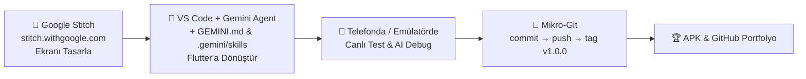

# 📱 Mobil Programlama Dersi 2025 — Yapay Zeka ile Mobil Uygulama Geliştirme (AI-Native)

Bu repository **14 haftalık** modern bir Mobil Programlama dersi için hazırlanmıştır.

- **Hafta 01 – 06:** Temel algoritmik düşünme ve programlama mantığı (Değişkenler, koşullar, döngüler, fonksiyonlar, List, Set, Map).
- **Hafta 07 – 14 (Güncel AI-Native Müfredat):** Öğrencilerin **Flutter/Dart ezberlemesine, tasarım programı bilmesine veya ayrı bir GitHub eğitimi almasına gerek kalmadan**; **VS Code + Google Stitch + Gemini Code Assist (Agent Mode) + Skills (`.gemini/skills/` & `GEMINI.md`) + Mikro-Git** yöntemleriyle uçtan uca çalışan, telefona kurulabilir (APK) profesyonel bir mobil uygulama geliştirme yolculuğu!

---

## 🎯 Dersin Yeni Nesil Hedefleri (Hafta 07 – 14)

- **Kod Ezberlemeden Uygulama Geliştirme:** **VS Code** üzerinde R-B-G-K Prompt Mühendisliği, Kullanıcı Hikâyeleri (User Stories) ve AI Debugging ile **Gemini Code Assist**'i yöneterek çalışan Flutter mobil uygulamaları üretmek.
- **Tasarım Bilmeden Profesyonel UI (Vibe Design):** **Google Stitch** (`stitch.withgoogle.com`) ile ilk haftadan itibaren metin/eskiz kullanarak modern mobil ekranlar tasarlayıp **VS Code içindeki Gemini** ile birebir koda dönüştürmek.
- **AI Agent & Skills Mimarisi:** Kendi proje anayasanı (`GEMINI.md`) ve tekrar kullanılabilir özel yeteneklerini (`.gemini/skills/`) yazarak VS Code Agent Mode ile tutarlı, çok ekranlı uygulama geliştirmek.
- **Her Hafta 1-2 Komutla Doğal Git & GitHub (Mikro-Git):** Sıkıcı teorik GitHub dersi yerine, 8 hafta boyunca proje geliştirirken sadece o haftanın ihtiyacına uygun 1-2 git komutuyla gerçek bir geliştirici akışı kazanmak.
- **Gerçek Ürün & Portfolyo:** 14. haftada kendi ikonuna, Splash ekranına, koyu moduna, canlı API'sine, kalıcı hafızasına ve otomatik testlerine sahip **Android APK** dosyasını çıkarıp **GitHub Release (`v1.0.0`)** olarak yayınlamak.

---

## 🗺️ 14 Haftalık Ders Programı

### 🧩 Bölüm 1: Algoritmik Düşünme & Temel Programlama Mantığı (Hafta 01 – 06)

| Hafta | Konu Odak Alanı | İçerik / Öne Çıkanlar | Klasör |
|---|---|---|---|
| **01** | Giriş, Temel Sözdizimi | Değişkenler, tipler, basit I/O | [`Hafta-01/`](Hafta-01/README.md) |
| **02** | Kontrol Akışı | `if/else`, `switch`, karşılaştırmalar | [`Hafta-02/`](Hafta-02/README.md) |
| **03** | Fonksiyonlar | Parametre, geri dönüş, yardımcı fonksiyonlar | [`Hafta-03/`](Hafta-03/README.md) |
| **04** | Koleksiyonlara Giriş | `List` temelleri, döngüler, temel algoritmalar | [`Hafta-04/`](Hafta-04/README.md) |
| **05** | Gelişmiş Liste & Veri İşleme | Filtreleme, `reduce/fold`, Set/Map'e giriş | [`Hafta-05/`](Hafta-05/README.md) |
| **06** | Set & Map Yoğun Pratik | Benzersiz veri, frekans analizi, Map filtreleme | [`Hafta-06/`](Hafta-06/README.md) |

### 🚀 Bölüm 2: Yapay Zeka ile Mobil Uygulama Geliştirme (Hafta 07 – 14)

> 📋 **Tüm Öğrenciler İçin Resmi Yol Haritası:** 8 haftalık dönem projesi senaryosu, seçilebilir 8 proje kataloğu, öğrenci proje kimlik kartı (`PROJE-KARTIM.md`) ve 100 puanlık değerlendirme rubriği için bkz. **[Hafta 07 — Dönem Projesi Ana Planı](Hafta-07/PROJE-PLANI.md)**

| Hafta | Ders Başlığı | AI & Tasarım Yöntemi | Mikro-Git Adımı | Etkileşimli Animasyonlar | Klasör |
|---|---|---|---|---|---|
| **07** | **Google Stitch ile Tasarla → VS Code Gemini ile Kodla** | Proje Seçimi, VS Code Kurulumu, **Google Stitch → R-B-G-K Prompt** | `git init`, `git status` | Stitch→Gemini Akışı + Prompt Karşılaştırma GIF | [`Hafta-07/`](Hafta-07/README.md) |
| **08** | **VS Code Gemini Agent Mode & 3 Ekranlı Mimari** | Chatbot vs Agent Mode, Plan→Onay→Uygula, 3 Ekran & Alt Menü | `git add .`, `git commit` | Agent Farkı + 3 Ekran Geçiş + Git Save GIF | [`Hafta-08/`](Hafta-08/README.md) |
| **09** | **Skills (`.gemini/skills/`), `GEMINI.md` & İlk GitHub Yedeği** | Proje Anayasası, özel Skill dosyası, kısa prompt ile standart ekran | `git remote add`, `git push` | Skills Mimarisi + GEMINI.md Etkisi GIF | [`Hafta-09/`](Hafta-09/README.md) |
| **10** | **Etkileşimli Ekranlar, Formlar ve Durum (State)** | Kullanıcı Hikâyesi (User Story) ile ekle, filtrele, geri almalı sil | `git log --oneline`, `git diff` | Canlı Görev State + Etkileşimli Döngü GIF | [`Hafta-10/`](Hafta-10/README.md) |
| **11** | **Veri Kalıcılığı ve Canlı API Bağlantısı** | Yerel Hafıza (`shared_preferences`) + Canlı JSON API (`http`) | `git checkout -b`, `git switch` | API & Hafıza Akışı + Git Branch GIF | [`Hafta-11/`](Hafta-11/README.md) |
| **12** | **AI Debugging, Kalite Denetimi ve Otomatik Test** | 3'lü Hata Paketi, Kalite Denetçisi, AI ile `flutter test` | `git merge`, `git push` | AI Debugging + Git Merge GIF | [`Hafta-12/`](Hafta-12/README.md) |
| **13** | **Görsel Cila, Koyu Mod, İkon & Açılış Ekranı (Splash)** | Stitch Dark Mode, `AnimatedContainer`, `flutter_launcher_icons`, Splash | `git restore`, `git pull` | Koyu Mod & Cila + İkon/Splash & Restore GIF | [`Hafta-13/`](Hafta-13/README.md) |
| **14** | **APK Derleme, Gerçek Telefon Testi, GitHub Vitrin & Final** | `flutter build apk --release`, AI README, 5 Dk Canlı Demo | `git tag v1.0.0`, `git push --tags` | APK Pipeline + Portfolyo Vitrini GIF | [`Hafta-14/`](Hafta-14/README.md) |

---

## 🔄 Uçtan Uca AI-Native Geliştirme Akışımız



---

## 🛠️ Öğrenciler İçin Kullanılan Temel Araçlar

| Araç | Ne İçin Kullanıyoruz? | Erişim |
|---|---|---|
| **Visual Studio Code (VS Code)** | Ana geliştirme ortamımız (Flutter eklentisi + yerleşik terminal + Git yönetimi) | [code.visualstudio.com](https://code.visualstudio.com) |
| **Gemini Code Assist (VS Code Eklentisi)** | Google Gemini Sohbet & **Agent Mode** ile kod üretme, çoklu dosya düzenleme ve hata ayıklama (`GEMINI.md` + `.gemini/skills/`) | VS Code Marketplace: `Gemini Code Assist` |
| **Google Stitch** | Tasarım bilmeden metin/eskiz ile profesyonel mobil UI, Koyu Mod & ikon tasarımı | [stitch.withgoogle.com](https://stitch.withgoogle.com) |
| **Flutter SDK** | VS Code içinde mobil uygulamayı çalıştırma (`F5` / `flutter run`), test (`flutter test`) ve Android APK derleme | [flutter.dev](https://flutter.dev) |
| **Git & GitHub** | VS Code terminalinden her hafta 1-2 basit komutla projeyi yedekleme ve finalde portfolyo olarak sergileme | [github.com](https://github.com) |

---

## 🚀 Hızlı Başlangıç

```bash
git clone https://github.com/ibrahimayaz/Mobil-Programlama-Dersi-2025.git
cd Mobil-Programlama-Dersi-2025
```

> **Öğrencilere Tavsiye:** İlk olarak [Hafta 07 — Dönem Projesi Ana Planı](Hafta-07/PROJE-PLANI.md) dosyasını okuyarak projenizi seçin, ardından Hafta 07'den başlayarak her haftanın animasyonlu rehberini ve Mikro-Git adımını takip edin!

---

## 📝 Lisans
Eğitim amaçlı kullanıma açıktır.
